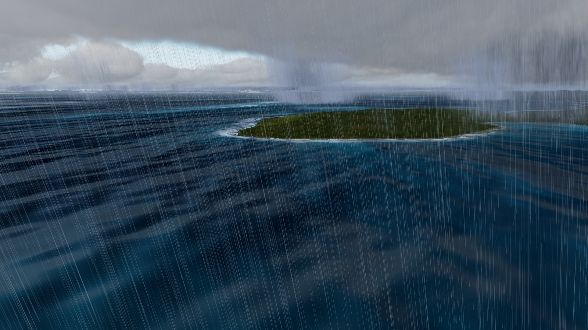
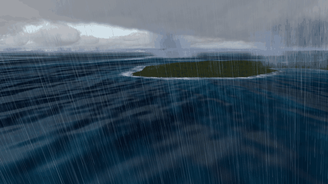
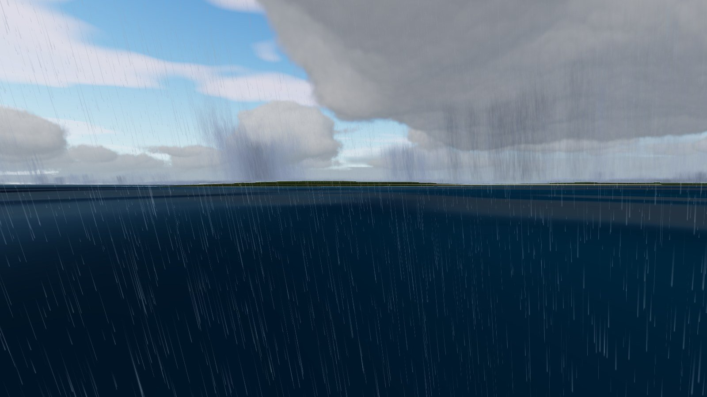
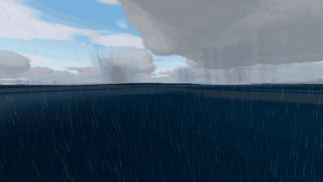
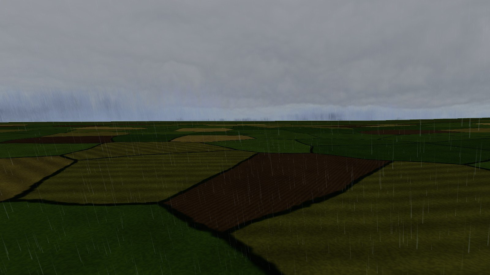
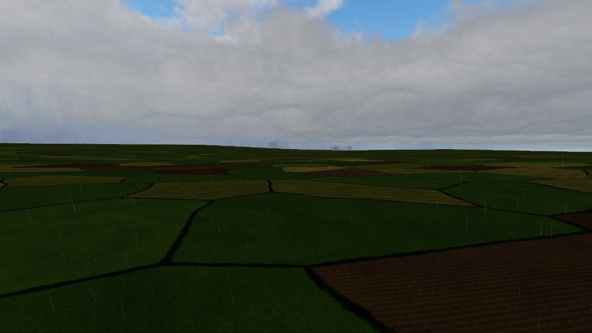
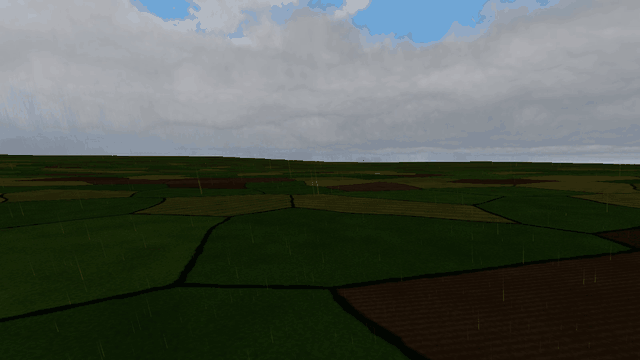
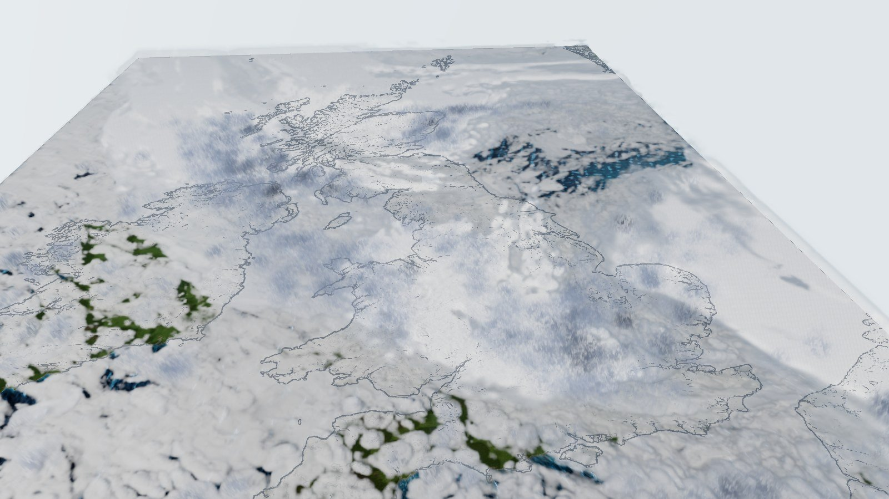
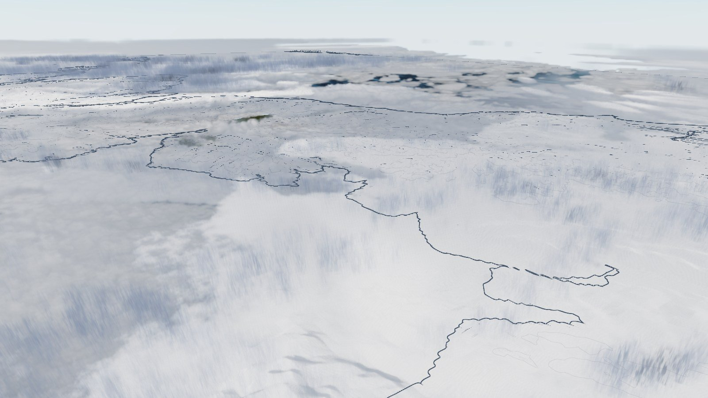
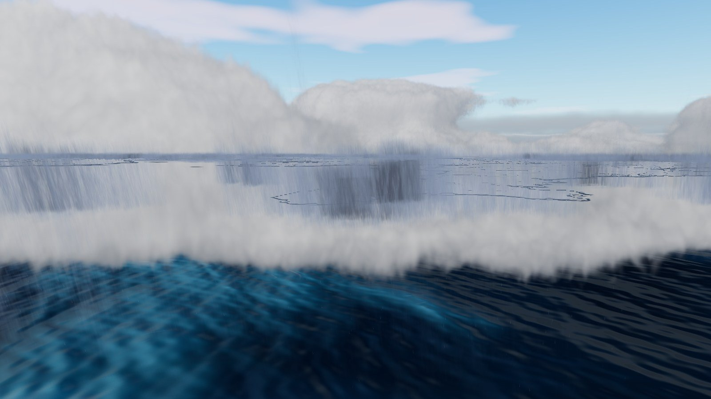

# Animated rain

Animated rain that shows how heavy the rain is, from drizzle to a downpour, both from the overview and up close.
It replaces the raymarched rain shafts from [ukv-clouds.md](ukv-clouds.md). Those were static and hard to see, and
Andy did not like them. They are now off behind the `uRainShafts` uniform in `src/weather/cloudShaders.ts`.

Data: the same UKV hour as the clouds (run 2026-10-21 09Z, valid 12Z). Rain rate comes from the
`precipitation_rate` channel, and cloud base and CAPE from `public/data/ukv-clouds-2d.png`. In this hour 28% of
cells have rain over 0.1 mm/h, 8% over 1 mm/h and 0.6% over 4 mm/h. The heaviest is 23 mm/h.

## Research

How games and papers render rain, and what each approach is good for:

| Technique | Where | Good for | Notes |
|---|---|---|---|
| Screen-space scrolling rain layers | Tatarchuk, ATI ToyShop (SIGGRAPH 2006) | Cheap dense rain close to the camera | Several layers of a streak texture at different parallax depths, plus a post blur for mist. Drops and streaks are biased towards white so the rain reads as heavier, a film trick. 10–15k velocity-stretched billboards on top, and 5–8k splash particles. |
| GPU particles in a box that wraps around the viewer | Rousseau et al., *GPU Rainfall*, JGT 2008 | Individual falling drops | A box of about 100 m around the user. Drops leaving one side come back on the other, so no spawning is needed. They found 10–20k drops convincing, and drops under 2 mm more realistic than larger ones. |
| Streak appearance from measured drop oscillation | Garg and Nayar, SIGGRAPH 2006 (Columbia streak database) | Physically right streak brightness under each light | About 3,150 rendered streak images over light and view angles and oscillation phase. More than a stylised map needs. |
| Rain as a participating medium in the cloud march | Horizon / Nubis (Schneider, SIGGRAPH 2022) and our earlier shafts | Distant rain curtains under storm clouds | Worked badly here: from the overview the whole rain column is only a few pixels tall, and it does not move. |

Physics that sets the look for each rain rate:

- **Drop size.** Marshall–Palmer: the median volume diameter is D₀ = 3.67 / (4.1 R^-0.21) mm. That gives
  0.55 mm at 0.1 mm/h, 0.9 mm at 1 mm/h and 1.8 mm at 25 mm/h.
- **Fall speed.** Atlas et al. (1973): v = 9.65 − 10.3 e^(−0.6 D) m/s. That gives about 2.3, 3.6 and 6.0 m/s for
  those sizes, so heavy rain falls about 2.7 times faster than drizzle.
- **Extinction.** Shipley et al. (1974): σ = 0.16 R^0.74 per km. This sets how opaque a rain curtain looks.

## How it works

`src/weather/rain/rain.ts` and `rainShaders.ts` form a separate module. It draws after the cloud composite, so it
does not touch the cloud shader. The cloud layer exposes `overlay` (scene depth, the cloud texture, opacity and
scale settings) for it.

- **Two kinds of sprite.** *Streaks* are single falling drops, each a motion-blurred camera-facing quad. *Curtains*
  are wide, soft, camera-facing sprites with a noise streak texture that scrolls at the rain's fall speed. They carry
  the rain from about 10 km out to the whole-UK overview. Seen from the side a curtain is a shaft under the cloud.
  Seen from above it is a streaky patch over the rain area.
- **Tiers that wrap around the camera.** Streaks come in 9 tiers of 60k (meant for views 20 m to 160 km away) and
  curtains in 4 tiers of 40k (30 to 800 km). Each tier is a box of drops 6× its distance across, centred on the
  camera, with wrap-around as in Rousseau et al. Drops stay put in the world as the camera moves. A hat weight in
  log distance hands drops from one tier to the next, so the number on screen stays about the same at every zoom.
  In the tiers closer than the column is tall, drops also wrap vertically around the camera, so rain at ground level
  is dense instead of spread over a 5 km column.
- **Columns.** Drops appear part way up the cloud: 0.8 km above the cloud base for layered cloud, up to 2.5 km for
  convective (high-CAPE) cloud. They fall to the terrain. Heights follow the cloud height slider.
- **Heaviness.** One rate drives everything. Rain covering 2 km cells would look like soft blobs, so the rate is
  first broken up with value noise (×0.35 to ×1.65), giving rain areas ragged edges. Then:
  - drop count rises from about a fifth of the maximum in drizzle to all drops at about 7 mm/h and over;
  - fall speed follows Marshall–Palmer and Atlas;
  - streaks get longer, wider and more opaque;
  - curtain opacity follows Shipley along a fixed path (4 km across a shaft, the column depth looking down);
  - curtain colour goes from pale blue-grey haze to dark grey.
- **Time-lapse.** Real drops barely move on a map seen from 50 km up. Fall speed is scaled by a factor that depends
  on the camera's height above the ground: 2× at 25 m, rising to 250× from about 3 km up. The rain clock is
  integrated on the CPU, so a change of factor does not make drops jump.
- **Wind.** There is a fixed south-westerly slant for now (UKV wind is not baked yet).
- **Occlusion.** Each fragment is tested by hand against the scene's logarithmic depth texture, with a soft edge
  where drops reach the ground. Rain behind cloud is dimmed by the cloud's alpha, and the "Rain through cloud" slider
  (default 0.6) lets some of it show through, so rain under an overcast still reads from above.
- **Seen from the ground.** A camera height factor (0 near the ground, 1 from about 5 km up) softens the curtains
  for ground views: pale, nearly neutral grey close to the sky's brightness, faint streak texture, and no rain shown
  through cloud. The dark, strongly streaked curtains are kept for the map, where they help the rain read over white
  cloud. (Added after the atmosphere work showed the curtains as dark navy streaks along the horizon at ground level.)
- **HUD.** An "Animated rain" switch and "Rain strength" and "Rain through cloud" sliders. Rain is drawn only while
  the cloud layer is on, because it needs that layer's depth texture.

## Screenshots

Rendered on Andy's AMD Radeon RX 7700S through ANGLE / Direct3D 11 at 1600 × 900, using
`node scripts/rain/gpu-shots.mjs`. The animations are 12 consecutive screenshots, so they run faster than real time.

**Heavy rain, 2 km up over the sea (about 8 mm/h).** Dense, long, slanting streaks, with curtains hanging from the
deck behind.

**Heavy rain at ground level.** At the edge of a rain cell. Streaks fill the foreground and darker shafts fall from
the cloud to the right.

**Moderate rain (about 2 mm/h) and drizzle (about 0.4 mm/h) at ground level.** Fewer, shorter and fainter streaks,
falling more slowly.

**Overview.** The frontal rain band reads as blue-grey streaky patches through the cloud, darker where the rain is
heavier. On screen the streak texture scrolls.

**About 100 km out over the south-west.** Curtains over the cloud tops. They read as rain, but look like vertical
brush strokes rather than shafts.

**Shafts from 20 km, inside the low cloud.** The weakest view: the edges of individual curtain sprites show as
grey rectangles.

## Performance

Frame times over 300 frames on the RX 7700S, with rain on and off:

| View | Rain on (median / p95) | Rain off (median / p95) |
|---|---|---|
| Overview | 6.1 / 6.2 ms | 6.1 / 6.2 ms |
| Heavy rain, 2 km up | 6.1 / 12.1 ms | 6.1 / 6.2 ms |
| Heavy rain, ground | 6.1 / 6.2 ms | 6.1 / 6.2 ms |

The display caps the frame rate (vsync, about 165 Hz), so these numbers only show that rain fits inside the frame
budget, not what it costs. The one sign of cost is the p95 at 2 km. The vertex shaders handle about 700k sprites a
frame, and most are discarded early.

## Known gaps

- **Curtain sprite edges** show as rectangles in the 20 km view, and as brush strokes from about 100 km. Better
  options: fade curtains by how much of the sprite lies inside the rain area, use many narrower curtains, or march
  the curtain texture in the cloud pass at low resolution.
- **No splashes or ripples.** Drop impacts on the sea and ground, and wet-ground darkening and shine, would add a lot
  at ground level (Tatarchuk's splash particles).
- **Lighting.** Streak and curtain colours are fixed, not lit by the sun or shaded under the deck. Using the cloud
  shadow would let rain under thick cloud go darker.
- **Wind** is one fixed slant. UKV wind on height levels would let rain drift with the real wind.
- **Snow** (`snowfall_rate`, freezing level) is not handled.
- **One static hour.** When the clouds move to the next hour, the rain field needs blending in step with them.

## Sources

- Tatarchuk, [Artist-Directable Real-Time Rain Rendering in City Environments](https://advances.realtimerendering.com/s2006/Chapter3-Artist-Directable_Real-Time_Rain_Rendering_in_City_Environments.pdf), SIGGRAPH 2006 course notes
- Rousseau, Jolivet and Ghazanfarpour, [GPU Rainfall](https://classes.cs.uchicago.edu/archive/2022/fall/23700-1/papers/gpu-rain.pdf), Journal of Graphics Tools 13(4), 2008
- Garg and Nayar, Photorealistic Rendering of Rain Streaks, SIGGRAPH 2006, and the [Columbia rain streak database](https://www.cs.columbia.edu/CAVE/databases/rain_streak_db/rain_streak.php)
- Atlas, Srivastava and Sekhon (1973), Doppler radar characteristics of precipitation at vertical incidence, Rev. Geophys. 11(1), fall speed formula as implemented in [disdrodb](https://disdrodb.readthedocs.io/en/latest/_modules/disdrodb/fall_velocity/rain.html)
- Marshall and Palmer (1948), drop size distribution (Λ = 4.1 R^-0.21 mm⁻¹); Shipley et al. (1974), rain extinction, via [volumetric-clouds-and-rain.md](volumetric-clouds-and-rain.md)
- Schneider, [Nubis, Evolved](https://advances.realtimerendering.com/s2022/SIGGRAPH2022-Advances-NubisEvolved-NoVideos.pdf), SIGGRAPH 2022 (cited, not opened)

Contains Met Office data © Crown copyright, licensed under CC BY-SA 4.0.
