# Cloud lab

The cloud lab is a separate page, `clouds.html`, for tuning how each cloud type looks before UKV data drives the
clouds on the map. It draws one cloud layer at a time over flat ground, in kilometres like the map, using the
raymarching approach recommended in [volumetric-clouds-and-rain.md](volumetric-clouds-and-rain.md). The eight presets
match the cloud types derived in that note.

Run `npm run dev` and open `/clouds.html`. The panel switches type and view, moves the sun, and exposes every layer
setting. When the view is still, the lab accumulates jittered frames into a clean image and then stops rendering.

## What each type looks like

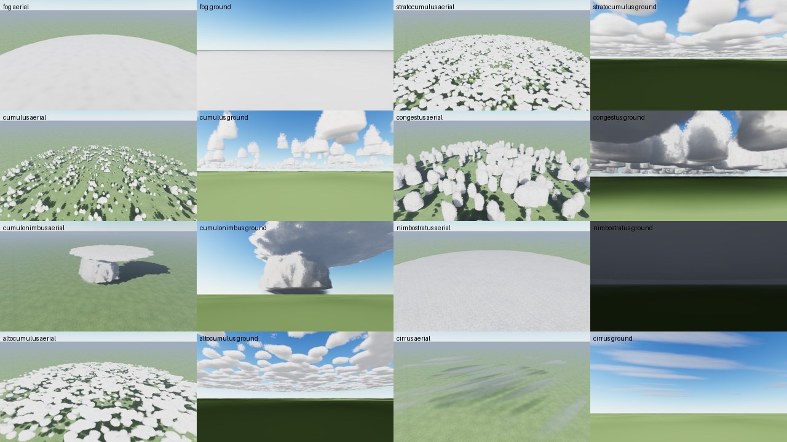

All screenshots are 960×540, rendered at 0.75 resolution and accumulated over 24 frames. The "from above" view
is an oblique map-like view from about 17 km up. The "from the ground" view looks up from 20 m. For fog, it looks
across the fog from a hilltop just above it. The cumulonimbus shots use a lower sun (20°) from the west; all others
use a 30° sun from the south-west.

| Type | From above | From the ground |
| --- | --- | --- |
| Fog / stratus | 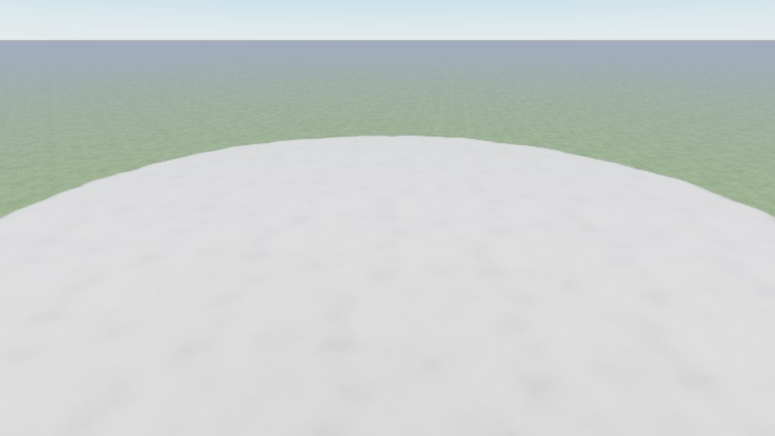 | 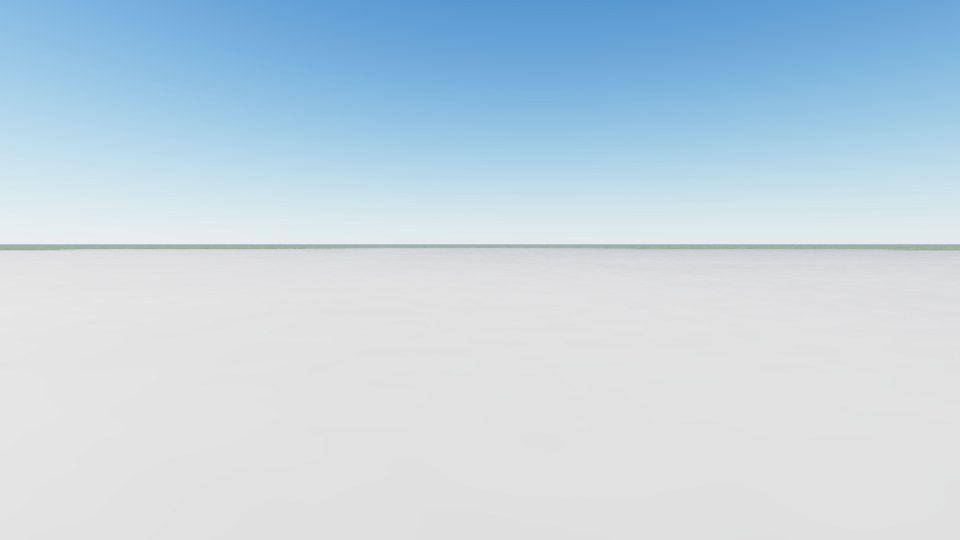 |
| Stratocumulus | 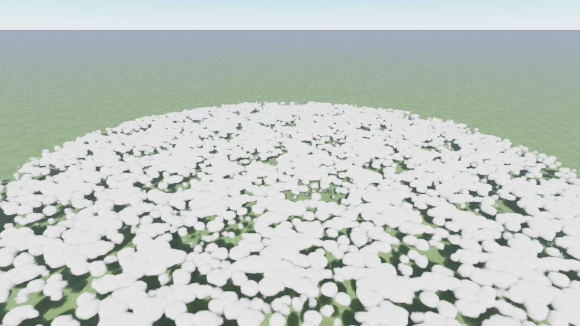 | 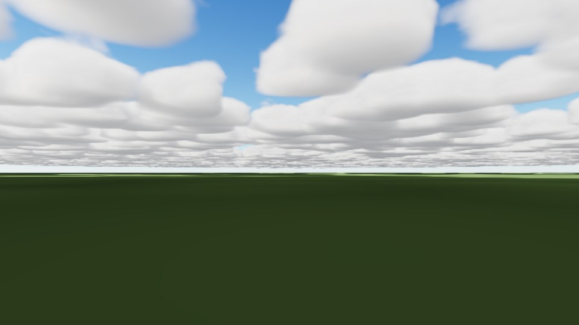 |
| Fair-weather cumulus | 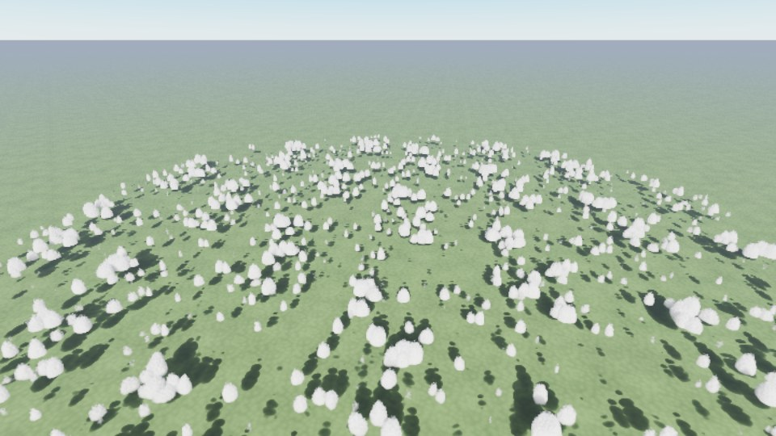 | 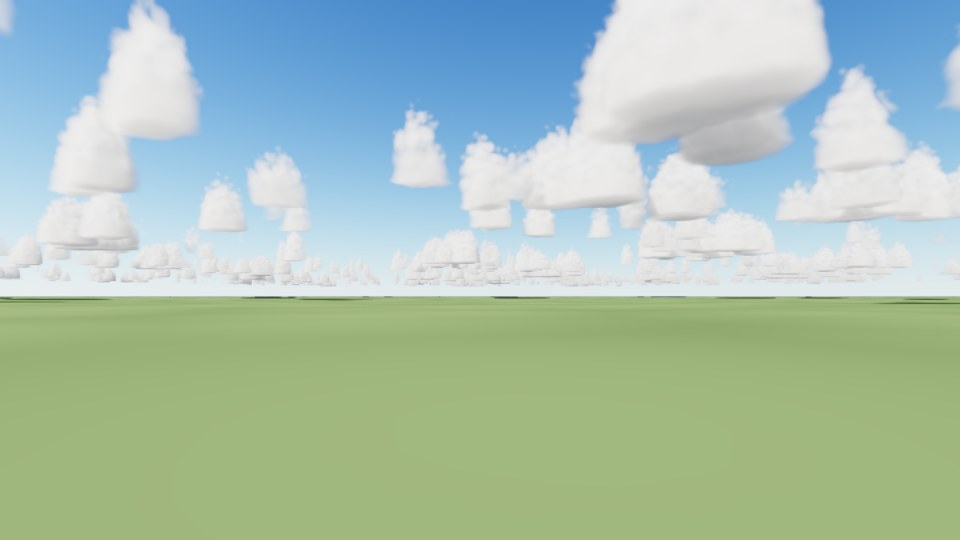 |
| Cumulus congestus | 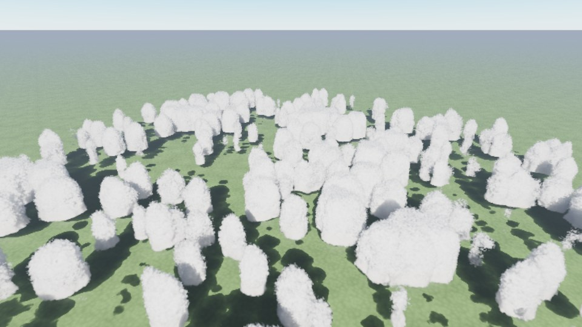 | 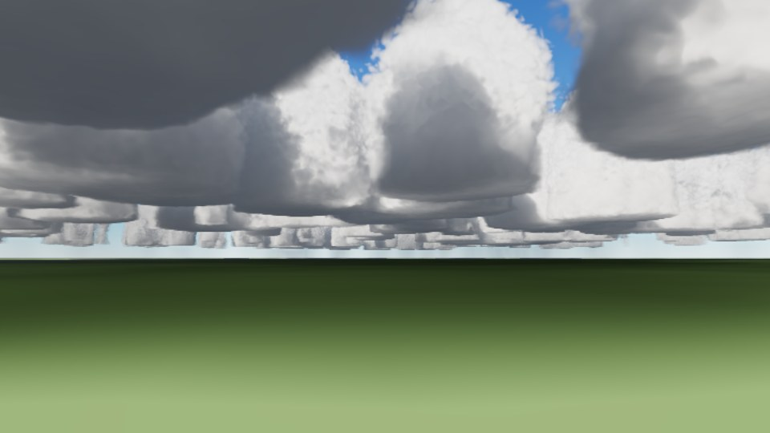 |
| Cumulonimbus | 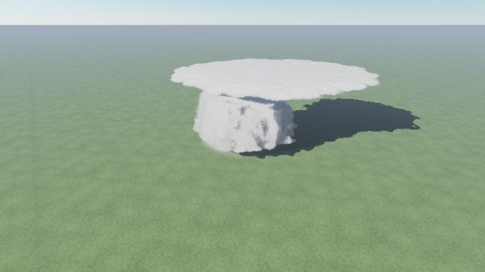 | 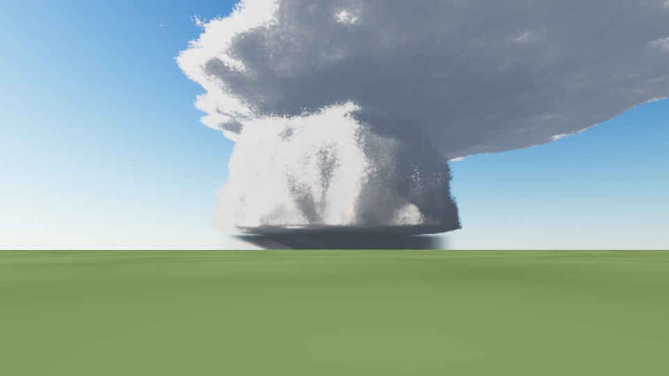 |
| Nimbostratus | 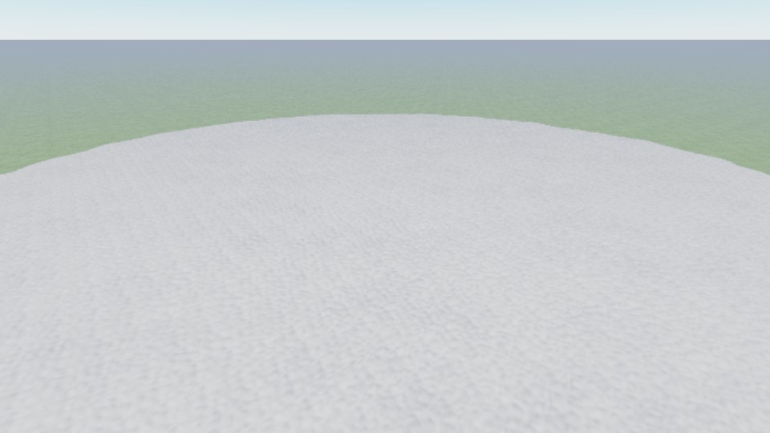 | 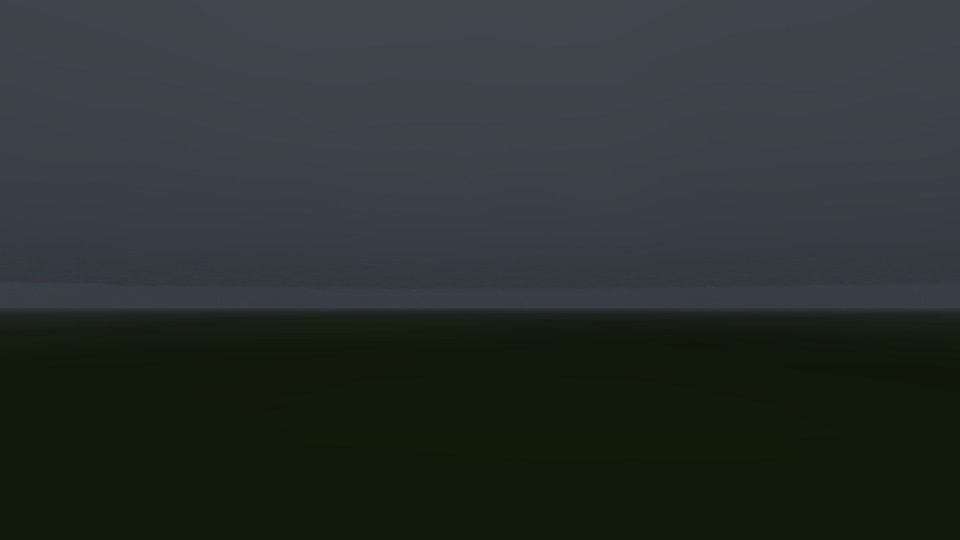 |
| Altocumulus | 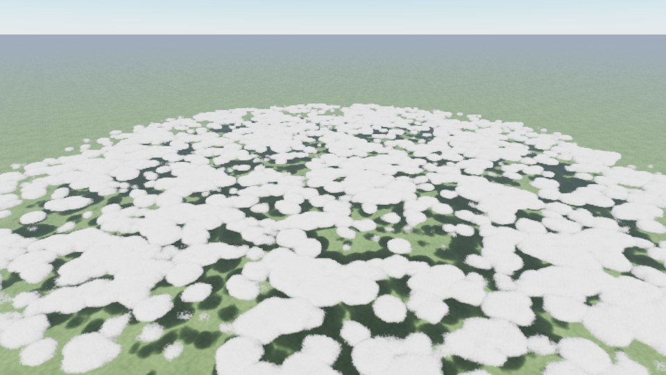 | 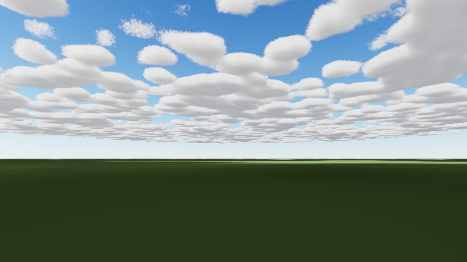 |
| Cirrus | 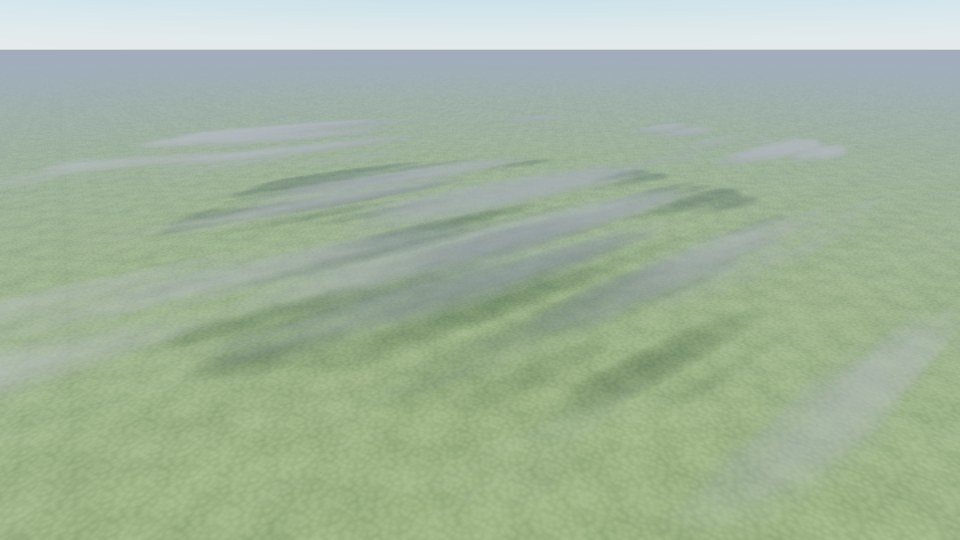 | 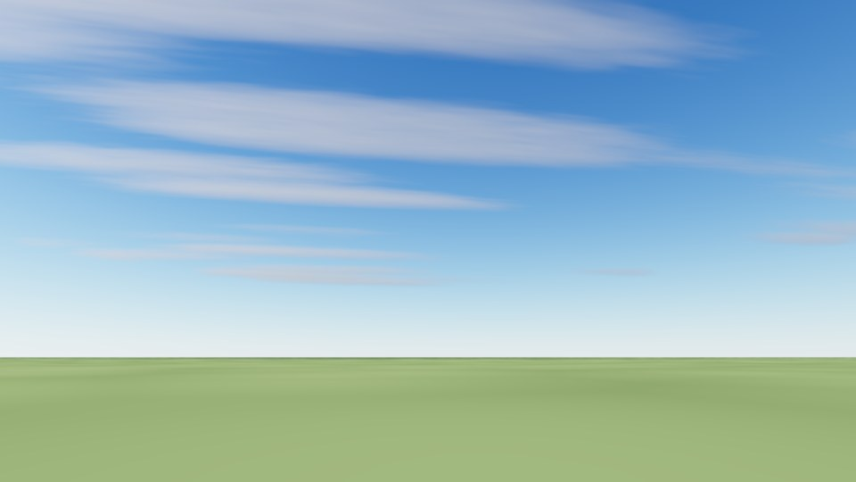 |

## How it works

- **Noise** (`src/clouds/noise.ts`). On start-up the page generates a tileable 128³ Perlin–Worley shape texture and
  a 32³ Worley detail texture, as in Horizon Zero Dawn. This takes about a second.
- **Placement and shape** (`src/clouds/cloudShader.ts`). A 2D cell field sets where clouds sit and how much of the
  sky they cover. A height profile rounds the base and top, the shape noise carves billows, and the detail noise
  erodes the edges into wisps. The cumulonimbus is a single storm cell instead: a tower that narrows upwards, then
  flares into an anvil sheared downwind.
- **Lighting.** Beer–Lambert attenuation along 6 steps toward the sun, a two-lobe Henyey–Greenstein phase function,
  four multiple-scattering octaves, a powder term, and height-dependent ambient light. Each march step uses
  energy-conserving integration. Distant cloud fades into haze at its transmittance-weighted mean distance.
- **Rain.** Below the cloud base, rain is a second medium with extinction σ = 0.16 R^0.74 per km (Shipley 1974, R in
  mm/h), streaked by stretched noise. It is lit by sunlight filtered through the cloud above.
- **Ground.** Flat ground lit by direct sun through the cloud, which gives moving cloud shadows, plus skylight that
  passes through cloud more easily than the direct beam.
- **Presets** (`src/clouds/presets.ts`). Each type sets base and top height, coverage, extinction (km⁻¹), cell
  size, noise scales, rounding, anvil, rain rate and lightning. These are hand-tuned starting values, not values
  taken from UKV.

URL parameters make the screenshots reproducible: `type`, `view` (`aerial`, `ground`, `side`), `sun` and
`azimuth` in degrees, `scale` (render resolution), `steps`, `frames`, `animate=0` for a still view, `gui=0`, and
`flash=1` to freeze a lightning flash. For example, `/clouds.html?type=cumulonimbus&view=ground&sun=20&azimuth=-100`.

## What is not right yet

- **Cloud bases are too flat and too sharp-edged.** Cumulus from the ground look a little like cotton boxes:
  vertical sides and a ruler-flat base. Real bases are flat but ragged.
- **The cumulonimbus has no visible rain curtain from a distance.** The rain is there (25 mm/h peak under the core)
  but too short and too dark to read at 24 km. It needs a brighter, grey-white shaft lit from the side, and a
  darker, lower base.
- **No lightning in the screenshots.** Flashes work while animating but are not shown above.
- **Fog is featureless from above.** That is roughly right for real fog, but it could use some texture and
  thinning near the edges.
- **Speed is unknown.** The screenshots came from headless Chromium on a software GPU, so they say nothing about
  frame rate. Interactive use on a real GPU needs checking, and half-resolution rendering with temporal
  reprojection is the next step if it is slow.

The next step after tuning is to swap the procedural cell field for the UKV volume baked by the pipeline, so the
same shader draws the forecast.
