# Ground-level camera

The map used to be locked to an orbit high above the UK. The camera now has two modes and a flight between them:

- **Map mode** is the old orbiting view (MapControls), now allowed down to 300 m above the ground, with zoom towards the cursor.
- **Ground mode** is a first person view that holds a height above the ground or sea, from 50 m (just above the rooftops) up to 8 km (a light aircraft). Andy found full eye level too low, so 50 m is the floor and where a dive ends.
- **The dive.** Double-clicking the map, or pressing **Drop to ground**, flies the camera down through the cloud layer to stand at that spot. **Esc** or **Back to map** climbs back out along the same path in reverse, looking at the ground the whole way, to the map view the dive started from (shifted by however far you moved on the ground).

Code is in `src/camera/`. `main.ts` only creates the rig and calls `rig.update(dt)` each frame.

## Controls

| Mode | Input | Action |
| --- | --- | --- |
| Map | Drag, right-drag, scroll | Pan, rotate, zoom |
| Map | Double-click | Dive to that point |
| Ground | Drag | Look around |
| Ground | WASD or arrow keys | Move (Shift = 5× faster) |
| Ground | Scroll, or Q/E | Sink and rise (proportional, 50 m to 8 km) |
| Ground | Double-click | Hop to that point in an arc |
| Ground | Esc | Climb back to the map |
| Both | H | Hide or show the control panel |

Speed scales with height, at 1.5 × height per second (75 m/s at 50 m).

## How it works

| File | Role |
| --- | --- |
| `cameraRig.ts` | Owns the modes, starts flights, handles double-click and Esc, fits the near plane and fog to height, and mounts the HUD button. |
| `flight.ts` | A camera flight along a cubic Bezier, paced by height above ground. |
| `groundControls.ts` | First person controls that hold a height above the ground. |
| `groundSampler.ts` | Ground height and ray hits, read from the terrain mesh itself. |

### The dive

The flight path is a cubic Bezier. It leaves along the current view direction and arrives down a 30° glide slope on the final heading. Mid-flight the camera looks along the direction of travel, so it looks down into the cloud deck as it dives and levels out to the horizon over the last few hundred metres.

A Bezier traversed at constant speed would spend the whole flight up high and hit the ground in one frame. The flight is paced instead so that **speed is proportional to height above ground** (plus 1.5 km). Time per segment is `length / (height + 1.5 km)`, so each halving of height takes about the same time. In practice it crosses hundreds of km in the first second, slows through the clouds, and glides in over the last kilometre to 50 m. A full dive from the opening view takes about 8 s (capped at 9 s), with smoothstep ease-in and ease-out in time. The field of view widens from 45° on the map to 60° at ground level during the flight.

The camera is kept above the ground all the way down by clamping to the terrain height plus a clearance.

The climb back is built as a dive from the map view to the camera's current position, then played backwards, so it mirrors the way down exactly (Andy asked for this after the first version turned to face the direction of travel on the way up).

### Ground height

`GroundSampler` reads the terrain mesh's own vertex grid and uses the same triangle split, times `mesh.scale.y`. That way, ground height is exactly the surface on screen at any vertical exaggeration, and changing the exaggeration slider in ground mode keeps you at the same height above ground. The sea surface (Y = 0) counts as ground. Ray hits for double-click march along the ray with steps that shrink near the ground, then bisect.

### Near plane and depth precision

The renderer already uses a logarithmic depth buffer, so precision holds from metres to thousands of km with one far plane (20,000 km). Only the near plane needs to move: it is set to a quarter of the height above ground, clamped between 0.3 m and 100 m. At 50 m it is about 12 m, and on the UK overview it is 100 m. The cloud pass reconstructs distance from log depth using only the far plane. Its view rays were first unprojected on the far plane, which broke down (and the clouds vanished) below about 10 m with a 0.4 m near plane, so since 01bae01 they are unprojected on the near plane instead. On the way down the dive, the cloud opacity also ramps to fully opaque as the camera nears the cloud layer (b4dff09), so the deck looks solid from below.

### Haze

The map's linear fog (600 to 2,600 km) is far too thin at ground level, where distant hills should fade into haze. The rig blends the fog distances geometrically with log height, from the map values above about 300 km to 4 to 140 km below about 200 m. The cloud pass reads `scene.fog` each frame, so the clouds' aerial perspective follows.

## Screenshots

These were taken before the floor was raised to 50 m, so the dive's last frame and the eye level views are at 1.7 m.

All shots were taken on Andy's machine (Radeon RX 7700S, Chrome, ANGLE/D3D11) at 1600×900, with the default settings: 4× exaggeration, 3× cloud height and stylised waves.

### The dive to Plymouth Hoe

These are frames from one flight from the opening view to Plymouth Hoe, facing south. Heights are camera Y in km (at 4× exaggeration).

| | |
| --- | --- |
| 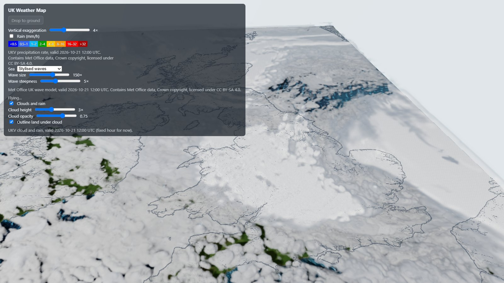 Start, 420 km | 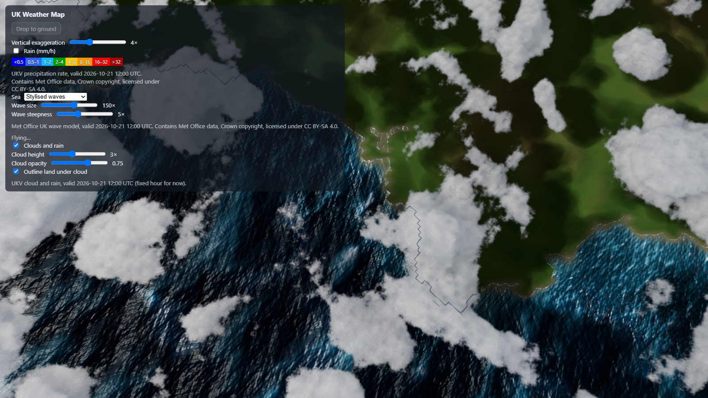 35%, 93 km: looking down into the cloud field |
| 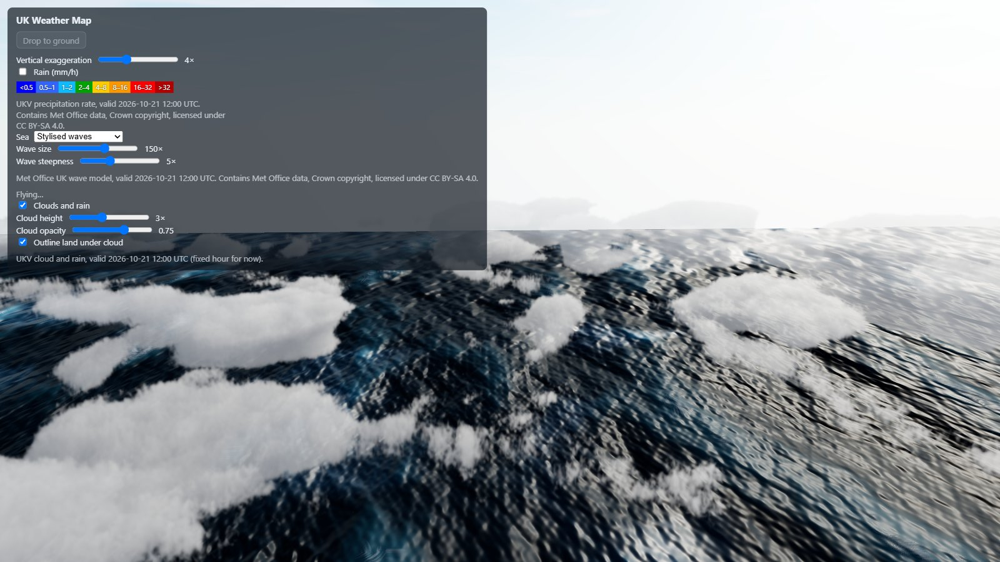 50%, 25 km: down among the cloud tops | 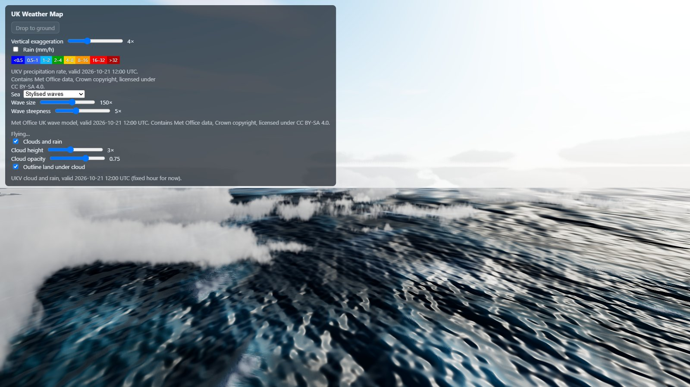 60%, 9 km: under the cloud, levelling out |
| 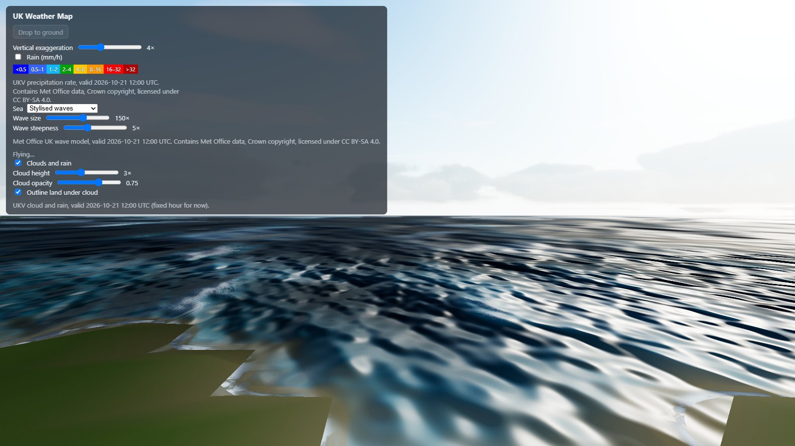 70%, 3 km | 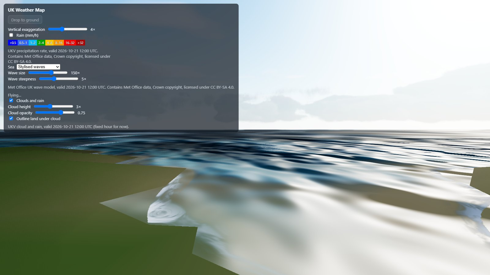 80%, 0.9 km: gliding in over the Sound |
| 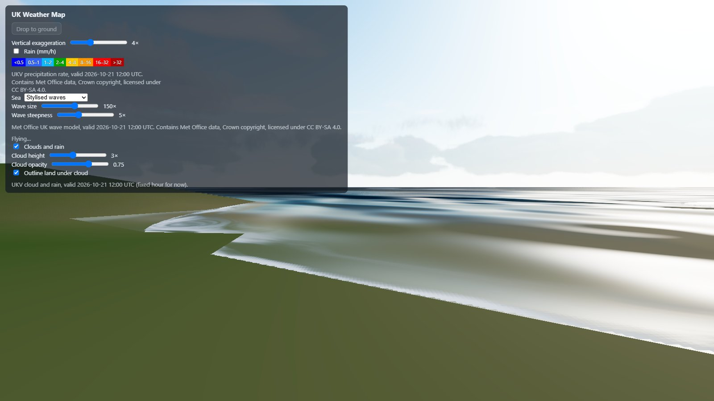 90%, 200 m | 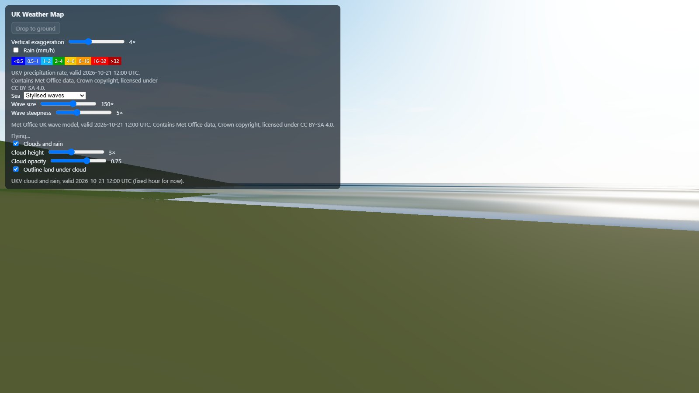 End: standing on the Hoe |

### Ground views

| | |
| --- | --- |
| 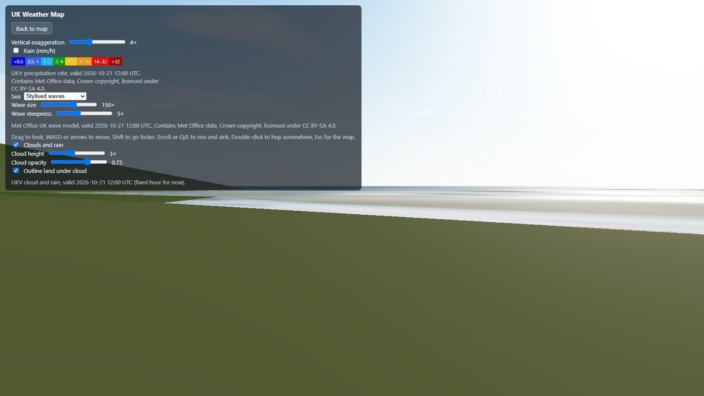 Plymouth Hoe at eye level, facing south | 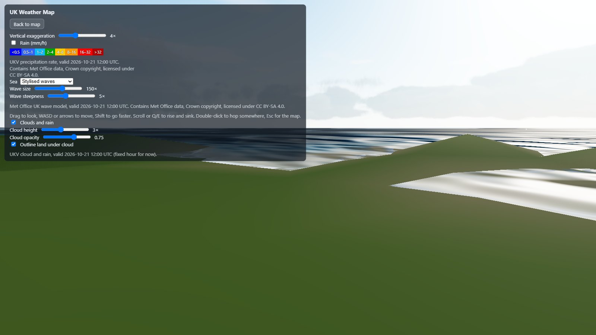 300 m over Plymouth |
| 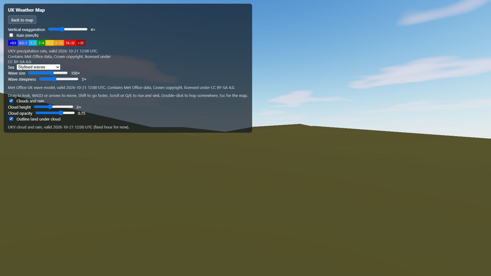 Dartmoor at eye level | 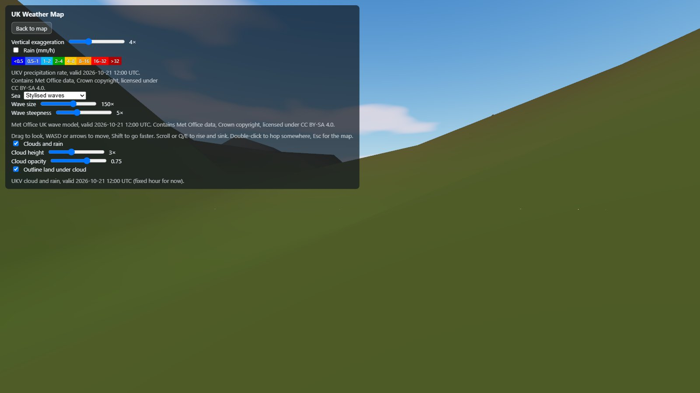 Snowdonia at eye level |
| 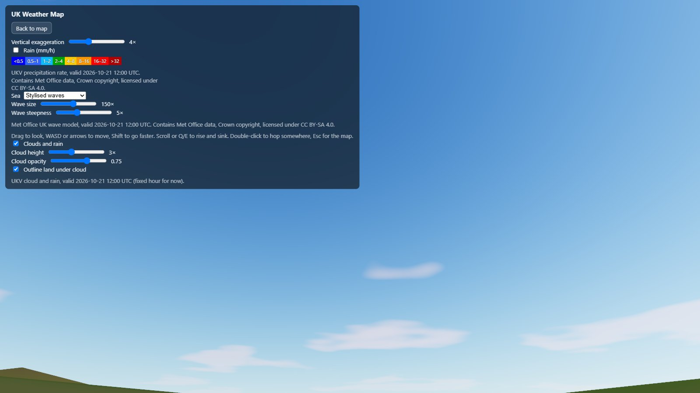 Looking up from the Hoe | 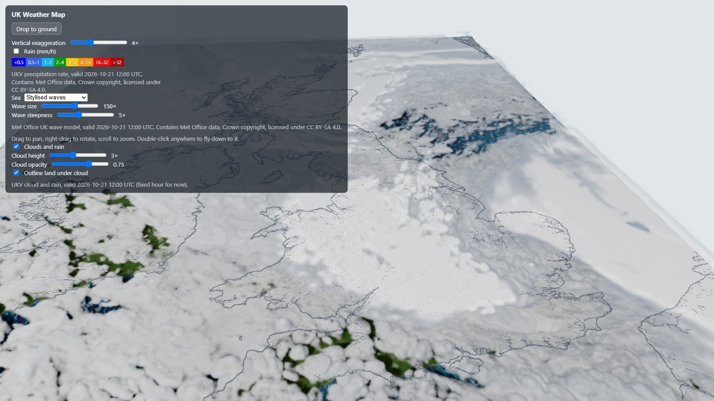 The opening map view, unchanged |

### Performance

Over one unfrozen dive (403 frames) the average frame time was 19.3 ms (about 52 fps), with a median of 18.2 ms, a 95th percentile of 30.4 ms, and a worst frame of 36.4 ms.

## What the ground view shows up

The camera works, but the screenshots show that most of the scene was only built to be seen from far above. These are the gaps, roughly in order of impact:

1. **Terrain detail.** The main app's terrain is a 2 km mesh with flat vertex colours, so at eye level the land is plain olive slopes, and Plymouth has no streets, buildings or trees. Being *in* Plymouth needs the terrain PoC's finer DEM, land cover, merged street blocks, footprints and trees (see `docs/terrain-towns-forests-poc.md`) brought into the main app near the camera, plus a ground detail texture.
2. **Coastline.** On 2 km triangles, the coast between lifted land and dropped seabed is jagged and stair-stepped close up (dive-80, dive-90). This also needs finer terrain near the camera.
3. **Sea scale.** The stylised waves (150×) are sized for the map view. At ground level they become huge smeared highlights and a pale band. Easing the wave exaggeration towards 1× as the camera nears the sea would fix this. It belongs in `src/sea/`.
4. **Clouds from below.** Low down at 9 km (dive-60), the cloud reads as a fog bank on the sea, and the sky near the sun is washed out. Looking up from the Hoe shows only a few soft clouds. The clouds thread has since made march steps grow with distance (23c1de1) so near cloud stays crisp from the ground, and is fixing the over-dark ground under overcast. Some dive frames were captured while that change landed, so they may predate it.

## Driving the camera from scripts

In dev builds, `window.rig`, `window.projection`, `window.camera` and `window.clouds` are exposed:

```js
const p = projection.toWorld(-4.1424, 50.3647); // Plymouth Hoe
rig.toGround({ x: p.x, y: 0, z: p.z }, { heading: Math.PI, height: 0.05, instant: true }); // facing south
clouds.invalidate(); // drop cloud history after cutting the camera
rig.toMap();
```

`heading` is a compass bearing in radians (0 = north, π/2 = east, π = south), and `height` is in km above the ground.
