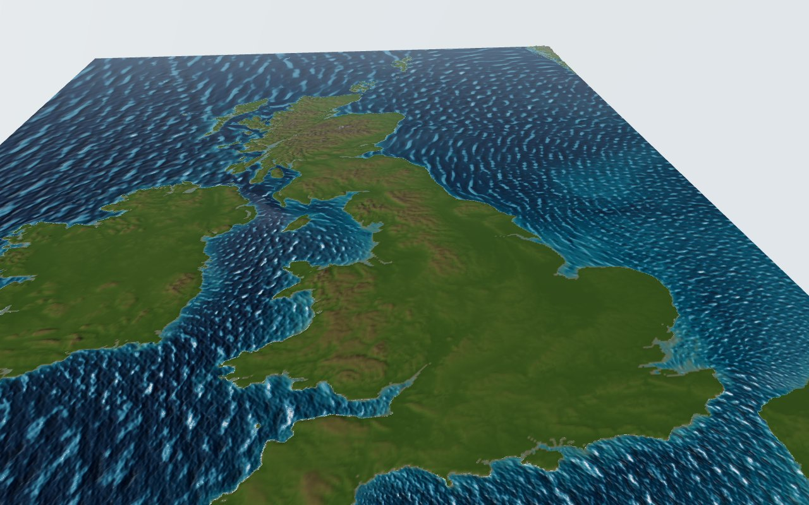
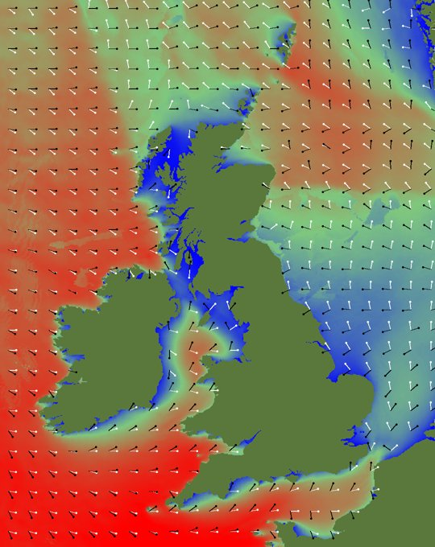
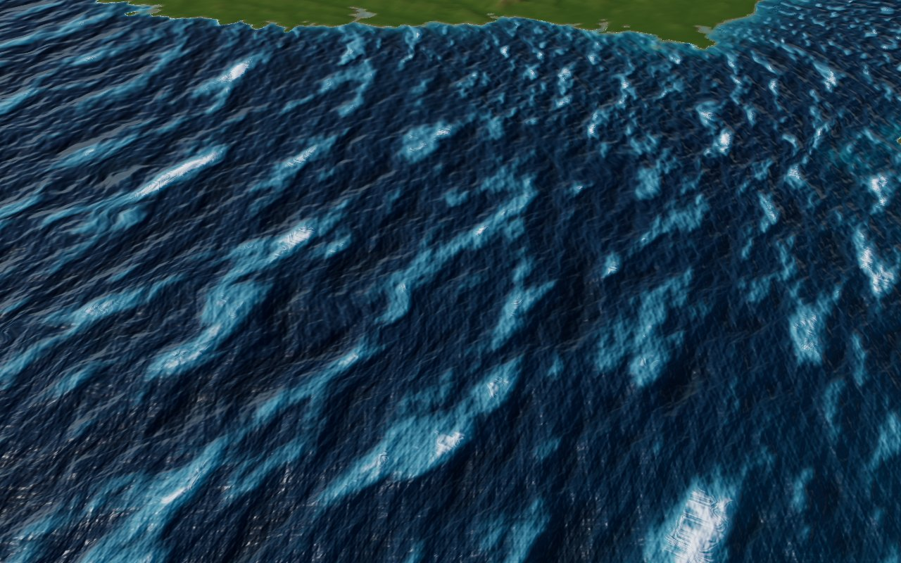
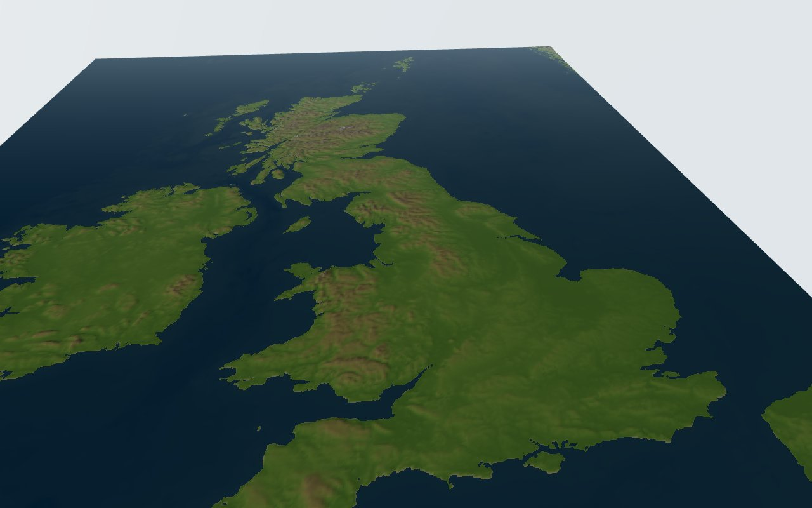
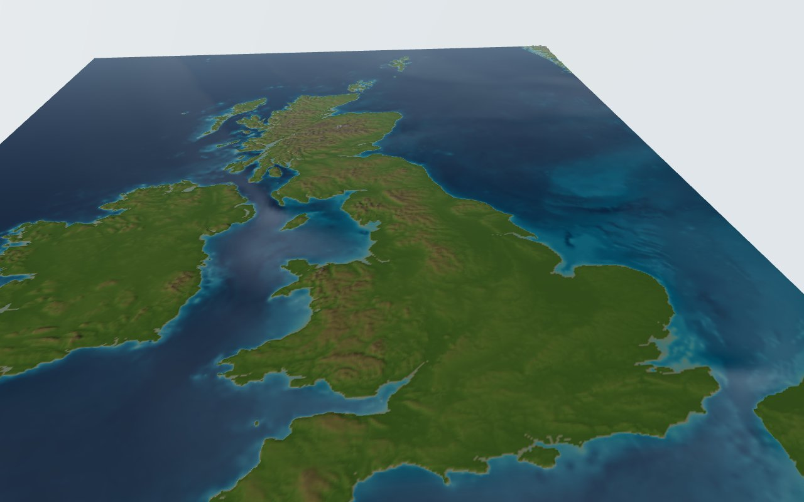
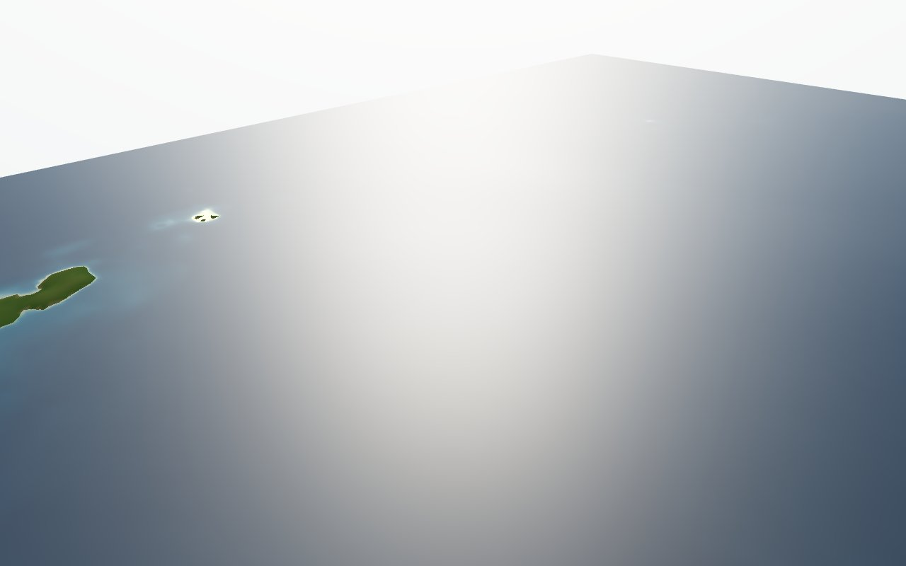
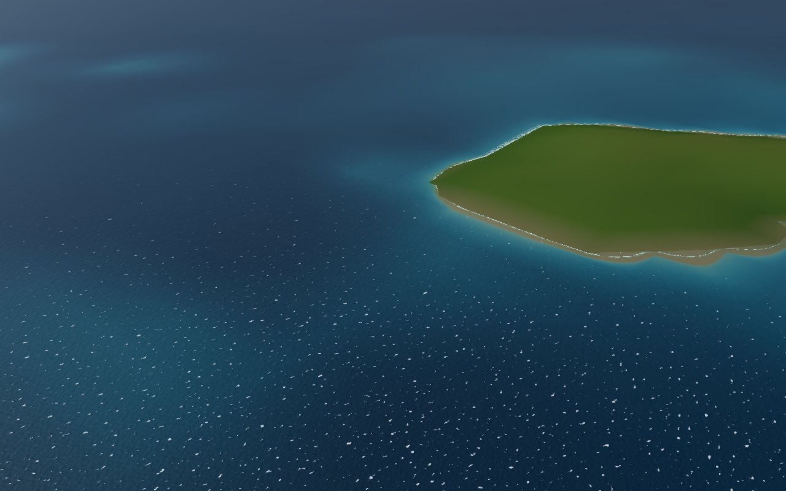
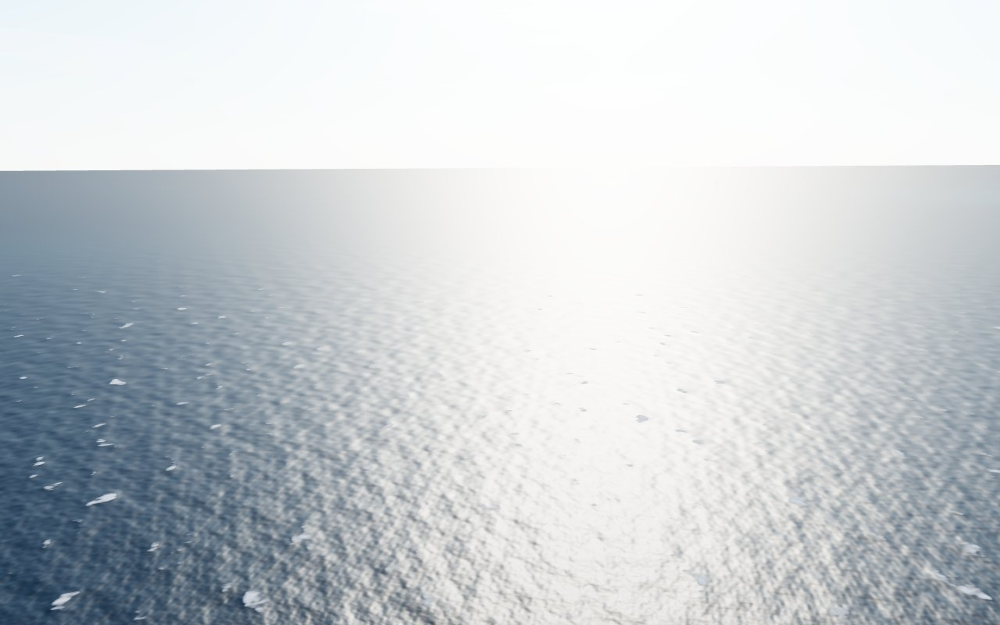
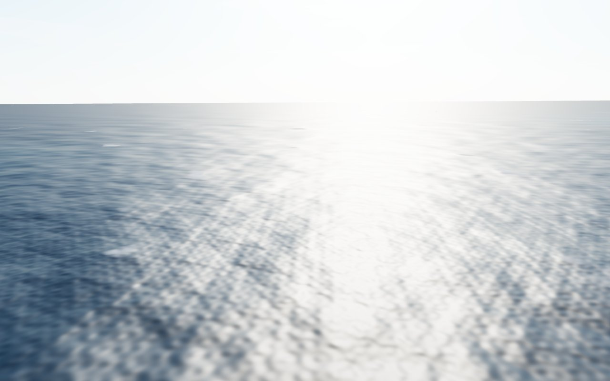

# Sea state: wave data and ocean rendering

Research note and proof of concept, 21 October 2026.

The Met Office publishes its UK wave model as free, keyless open data on AWS, in the same way as UKV. It gives
hourly significant wave height, period and direction on a 1.5 km grid, split into wind sea and up to three
swells, plus the 10 m wind it was driven by. That is enough to drive a spectral ocean shader, so the sea in the
app now shows the real conditions: wave size, direction and length, sun glint, whitecaps and surf.

Real waves are far too small to see from the overview, so the default is **stylised waves**: the same data,
blown up about 150 times and steepened so that relative roughness, wave size and direction read from the whole-UK
view (Andy, 21 Oct 2026). A true-scale **realistic** mode is kept for close-ups.

## Wave data sources

| Source | What it is | Access | Checked? |
| --- | --- | --- | --- |
| **Met Office UK wave model on AWS** (used) | WAVEWATCH III, "UK 1.5km Wave Standard Grid", runs 00/06/12/18 UTC from T-48h to T+143h, 2-year rolling archive | Bucket `met-office-nws-wave-model-data` (eu-west-2), anonymous HTTPS, CC BY-SA 4.0 | Yes: listed the bucket, downloaded and opened the 06Z run of 21 Oct 2026 |
| Met Office global wave model on AWS | Global WAVEWATCH III, 00/12 UTC runs to T+144h, 06/18 UTC to T+66h | Bucket `met-office-global-wave-model-data`, CC BY-SA 4.0 | Registry page only, files not opened |
| Copernicus Marine `NWSHELF_ANALYSISFORECAST_WAV_004_014` | The same Met Office 1.5 km NW European shelf wave model, distributed by Copernicus, hourly, 7-day forecast | Copernicus Marine data store | Product page only. It doesn't state on that page whether an account is needed, and I didn't check |

Sources: [AWS registry, NWS wave](https://registry.opendata.aws/met-office-nws-wave/),
[AWS registry, global wave](https://registry.opendata.aws/met-office-global-wave/),
[Copernicus product page](https://data.marine.copernicus.eu/product/NWSHELF_ANALYSISFORECAST_WAV_004_014/description).

The AWS NWS bucket is the obvious choice: same provider, same licence and same access pattern as the UKV data, no
key, and higher resolution than the global model. The Copernicus product appears to be the same model, so it
adds nothing for us.

### What's in the bucket

Layout: `nws-wave/YYYY/MM/DD/THHMMZ/b<run>_hi<start>-wave_uk_standard_v1-level_1-<parameter>.nc`. Each file is one
parameter for 24 hourly steps starting at `hi`, so a run is split into one file per forecast day. The 06Z run of
21 Oct 2026 had 79 files, 26 parameters per day, about 5 to 25 MB each.

Grid: regular lat/lon (WGS84), 958 × 1240 cells, 16°W to 13°E and 46°N to 62.74°N, about 0.0303° × 0.0135°.
Values are int16 with a scale factor, with land masked. Global attributes say the model is "WAVEWATCH III v7.13,
Met Office local branch", forced by the Global UM, NEMO AMM15 and Global WW3.

Parameters (variable names inside the files):

| Group | Files | Variables |
| --- | --- | --- |
| Total sea | `wave_significant_height`, `wave_mean_direction`, `wave_peak_period`, `wave_period_tm01`, `wave_period_tm02` | `VHM0`, `VMDR`, `VTPK`, … |
| Wind sea | `wind_wave_significant_height`, `_mean_direction`, `_peak_period`, `_directional_spread`, `_peak_energy` | `VHM0_WW`, `VMDR_WW`, `VTPK_WW`, … |
| Primary, secondary, tertiary swell | `primary_swell_wave_*`, `secondary_swell_wave_*`, `tertiary_swell_wave_*` | `VHM0_SW1`, `VMDR_SW1`, `VTPK_SW1`, … |
| Forcing and grid | `wave_grid_10m_wind`, `wave_grid_depth` | `WSPD`, `WDIR`, depth |

Directions are "from", in degrees clockwise from north. At 12Z on 21 Oct 2026 the sample had total Hs up to 5.5 m,
wind sea up to 5.0 m, primary swell up to 4.4 m with peak periods up to 17 s, and wind up to 21 m/s.

## Pipeline

[`pipeline/wave_to_grid.py`](../pipeline/wave_to_grid.py) downloads seven files for one run and valid time (wind
sea and primary swell height, direction and period, plus 10 m wind) and resamples them onto the terrain
heightmap's LAEA extent at 2 km. It writes three RGB PNGs and a JSON sidecar to `public/data/waves/`, about
780 KB in total. It:

- turns directions into propagation unit vectors before interpolating, so they never wrap through 0/360;
- rotates them from true north into LAEA grid north, which drifts by several degrees away from 2.5°W;
- fills land outwards from the nearest sea, so the shader can sample right up to the coast without seams;
- stores 8 bits per value: Hs in 5 cm steps, periods in 0.1 s, wind in 0.2 m/s, directions as (v + 1) × 127.5.
  The fields are smooth, so 8 bits with linear filtering is plenty.

Check of the resampled data against the terrain coastline. Colour is total Hs (blue low, red high), white arrows
are the wind sea and black arrows the primary swell, pointing where the waves travel:

The coastline in the wave field lines up with the heightmap's land mask, and the patterns are physically
sensible: Atlantic swell from the west, sheltered water in the lee of Ireland and in the Minch.

Secondary and tertiary swell are ignored for now. Adding them would need more texture channels and more shader
work per pixel.

## Rendering techniques

What the best real-time oceans do, and what fits a map that goes from 3,000 km away to 5 km away:

- **FFT ocean (Tessendorf 2001).** Sum thousands of waves from a statistical spectrum with an inverse FFT on a
  tiling patch, usually in several cascades. It is the standard for games and film. It suits a uniform sea, but
  our sea state varies over the map, and one FFT patch can't follow that without blending several patches.
  Three.js examples exist: [jbouny/fft-ocean](https://github.com/jbouny/fft-ocean) (WebGL) and the older
  `OceanShaders.js`.
- **Gerstner or sum-of-sines waves.** Cheap and controllable, but a few waves look repetitive.
- **Directional spectra.** JONSWAP / Pierson–Moskowitz frequency spectra with cos²ˢ directional spreading are
  the usual way to go from Hs, Tp and direction to individual waves. Horvath (2015),
  [Empirical directional wave spectra for computer graphics](https://doi.org/10.1145/2791261.2791267), is the
  graphics-oriented summary.
- **Filtering waves into the BRDF.** Bruneton, Neyret & Holzschuch (2010),
  [Real-time Realistic Ocean Lighting using Seamless Transitions from Geometry to BRDF](https://evasion.inrialpes.fr/Publications/2010/BNH10),
  move waves that are too small for a pixel into the reflectance model as slope variance. Without it, a sea seen
  from far away either aliases into noise or goes flat and loses its glint. This is the key technique for a map.
- **Slope statistics from wind.** Cox & Munk (1954) measured the sea's mean square slope from sun glint:
  σ² = 0.003 + 5.12×10⁻³ U (U in m/s at 12.5 m). Source:
  [Ocean Optics Web Book](https://oceanopticsbook.info/view/surfaces/cox-munk-sea-surface-slope-statistics).
  It sets how wide the sun's glint spreads.
- **Whitecaps.** Monahan & O'Muircheartaigh (1980) fit whitecap coverage as W = 3.84×10⁻⁶ U¹⁰·⁴¹ (fraction).
  Some papers write the same fit with 3.84×10⁻⁴, which is the same thing in percent; see
  [Table 1 here](https://www.mdpi.com/2072-4292/15/1/241). That gives about 1% at 10 m/s and 10% at 20 m/s.

## The proof of concept

Code: [`src/sea/`](../src/sea/). It is on by default. The HUD's **Sea** menu picks stylised waves (the default),
realistic waves at true scale, or the old flat sea. Stylised mode adds **Wave size** and **Wave steepness**
sliders.

The approach is a spectral sum of sines with Bruneton-style filtering, injected into Three.js's
`MeshPhysicalMaterial`:

1. **One fixed bank of waves for the whole map.** 16 wavelength bands from 600 m to 4 m, each with 12 directions
   (192 waves). The wave vectors never change, and only their amplitudes vary across the map. That keeps phases
   continuous however fast the sea state changes, which an FFT patch or locally chosen waves cannot do.
2. **Amplitudes from the local data.** Each pixel builds a directional spectrum from the wind sea and the swell:
   a Bretschneider (two-parameter Pierson–Moskowitz) spectrum for each from its Hs and Tp, spread around its
   direction with cos²ˢ (s = 4 for wind sea, 16 for swell). Each wave gets a = √(2 S(ω) D(θ) Δω Δθ), so the
   bank's variance adds up to Hs²/16.
3. **Shallow water.** Waves use the finite-depth dispersion relation ω² = g k tanh(k h) with depth from the
   terrain heightmap, so they slow down near the coast.
4. **No visible grid.** Each band's directions get a random rotation, wavelengths are jittered within the band,
   wave vectors snap to a lattice that repeats every 16.384 km, and the plane is gently warped with noise. The
   lattice lets the shader work relative to an origin near the camera, which keeps `sin()` arguments small
   enough for 32-bit floats.
5. **Seamless near to far.** A band fades out once it is under about 6 pixels per wavelength, and its slope
   variance goes into the roughness instead. Roughness also includes the Cox–Munk variance of the very short
   waves the bank doesn't model. Up close you see waves. From altitude you see the glint widen and narrow with the
   wind.
6. **Lighting.** GGX specular from the sun, boosted because the scene's sun is set for lighting land, plus the
   sky reflected from a prefiltered copy of the existing `Sky` (without its sun disc).
7. **Water body.** Light is absorbed along the view path, so the shallow seabed shows through and deep water goes
   navy. The sea is drawn with premultiplied blending, so the water fades over the shallows but reflections and
   glint don't.
8. **Whitecaps.** Monahan coverage from the wind, placed on the highest wind-sea crests and broken up by
   wind-aligned streak noise. Where the waves are too small to see, the same coverage is applied as an even
   whitening.
9. **Surf.** The distance to the drawn coastline comes from the terrain mesh height divided by its gradient.
   The surf zone is about 60 × Hs wide, from McCowan's breaking limit (H ≈ 0.78 × depth) on an assumed 1:50 beach.
   It fades to its average coverage when it's thinner than a pixel. Exposed coasts get more surf.

### Stylised mode (default)

The first version offered a Froude-scaled wave size slider up to 60×. That keeps slopes, so the shading barely
changes, and Andy found 60× not nearly enough to see waves from the overview. Stylised mode drops realism on
purpose:

- **Wave size**, 10× to 1,000× on a log slider, default 150×. A 12 s swell (about 225 m long) becomes about 34 km
  between crests, roughly 30 pixels in the default overview.
- **Wave steepness**, 1× to 12×, default 5×. This multiplies the slopes, so a 4 m sea shades much more strongly
  than a 1 m sea. That is what shows relative roughness.
- **Real periods**, sped up by 1.5×, instead of Froude scaling. That keeps the waves visibly moving from the
  overview.
- **Narrower directional spread** (s = 10 for wind sea, 40 for swell). The crests are longer, so their direction
  reads at a glance.
- **Crest and trough tint.** Crests are lightened and troughs darkened, so the waves read even away from the sun.
- **Surf** is widened 8×, not 150×, so it stays a coastal fringe.

Whitecap coverage still comes from the wind (Monahan), at 0.7× strength so it doesn't swamp the wave pattern.

### Realistic mode

At true scale, waves are visible only within a few kilometres. Further out, the sea is shaped by the
glint and whitecaps. The screenshots below show this mode. Its old wave size slider was replaced by the stylised
mode.

### Screenshots

These were taken with the data valid 12:00 UTC 21 Oct 2026 and Chromium's software renderer (SwiftShader).

| | |
| --- | --- |
|  |  |
| Before: the old flat sea | Realistic mode, same view. Shallows show the seabed, and the wind sets the glint |
|  |  |
| Looking towards the sun from 90 km over the Celtic Sea. The glint is wide because the wind is about 10 m/s | Off Cornwall from 12 km: whitecaps on the wind sea and surf along the coast |
|  |  |
| From 500 m off Land's End at true scale | The same view with the old Froude-scaled wave size at 15× |

### Limits and next steps

- **Only normals, no vertex displacement.** At map scale even 5 m waves are sub-pixel in height, so the surface
  stays flat and the waves are all in the shading. A camera-following displaced grid would only matter close up.
- **Performance not measured on a real GPU.** The worst case is 192 waves per pixel, but far pixels skip most bands.
  The screenshots came from a software renderer. If it is slow on weaker GPUs, the next step is to precompute
  the bank into a few FFT cascades or textures.
- **One time step.** The textures hold one valid time (12Z, to match the rain snapshot). Each file has 24 hourly
  steps, so animating through the forecast would only need more textures.
- **Not modelled:** secondary and tertiary swell, wave refraction and diffraction beyond what the model's own
  fields give, foam that persists and drifts after breaking, subsurface scattering in wave crests, and
  reflections of the terrain or clouds.
- **Tuned by eye:** the glint boost, sky reflection strength, water colours and absorption, surf width, and the
  spreading exponents. These are toy choices, not measurements.
