# Terrain, towns and forests: proof of concept

Research and prototypes for bringing the terrain up to a "best-in-class toy" standard: a ground texture that
reads as the real landscape, a recognisable shape for every town, and trees where the real forests are. Each
option is drawn at life size and at exaggerated scales so we can choose a representation before baking anything
for the whole UK.

The prototype is a separate page, so it does not touch the main map:

```
npm install
npm run dev            # then open http://localhost:5173/poc/terrain/
```

Every control is mirrored in the URL, e.g. `/poc/terrain/?area=plymouth&view=sound&buildings=blocks&cell=150&bscale=3&tscale=3`.

## Data: what is actually available

The OpenStreetMap servers (Overpass, Geofabrik) are blocked from the build container, so the prototype reads
[Overture Maps](https://overturemaps.org/) instead. Overture is a monthly, cleaned release that is largely OpenStreetMap
plus machine-learned building footprints and ESA WorldCover land cover, published as GeoParquet in a public S3 bucket
(`s3://overturemaps-us-west-2/release/2026-09-23.0/`, no key). That suits the eventual AWS bake well, because a batch
job can read just the row groups it needs straight from S3.

Building heights, checked for the Plymouth test box (lon -4.25 to -4.0, lat 50.33 to 50.45), release 2026-09-23.0:

| | Buildings | With `num_floors` (OSM `building:levels`) | With `height` |
|---|---:|---:|---:|
| From OpenStreetMap | 80,708 | 15,267 (19%) | 6,878 (8.5%) |
| From Microsoft ML footprints | 17,080 | 0 | 17,015 (ML estimate) |
| Total | 97,788 | 15,267 (16%) | 23,893 (24%) |

So OpenStreetMap does record storeys, but only for about one building in five here, and much less in rural areas
(Kielder box: 1,177 buildings, 25 with levels). The rest get a height from their class (house 6.5 m, apartments 13 m,
retail 8 m, garage 2.8 m...) or footprint size. For a toy this is fine: the outline of the city comes from the
footprints, which are close to complete, and the few tall buildings tend to be the ones that are tagged.

Trees and land cover in the same release:

- OSM woodland polygons (`landuse=forest`, `natural=wood`) as Overture `land` features: 719 in the Plymouth box,
  2,535 in the Kielder box. Overture keeps `forest` vs `wood` but not `leaf_type`, so the prototype treats managed
  `forest` and any woodland above 250 m as conifer and the rest as broadleaf. That is a heuristic, not data.
- 6,954 individually mapped trees (`natural=tree`) in the Plymouth box, mostly street and park trees.
- ESA WorldCover classes (forest, shrub, grass, crop, urban, bare, wetland) fill gaps OSM does not map. WorldCover
  labels a lot of hedged Devon pasture as "shrub", so the prototype only treats shrub as moorland above 250 m.
- OSM land use (residential, industrial, parks, farmland), water and every road and railway.

For the UK as a whole, the Overture building row groups whose bounding boxes fall in the UK box hold about 30.3
million rows (6.7 GB uncompressed). That is an upper bound, since edge row groups include parts of Ireland and France.

Elevation is AWS Terrain Tiles at zoom 13 resampled to 20 m (Plymouth) and 25 m (Kielder). I have not checked the
native resolution of the UK source inside those tiles, so treat finer detail as unverified.

## What the prototype builds

`scripts/detail/build_area.py <area>` writes `public/data/detail/<area>/` for a small box:

- `height.png`: Terrarium-encoded heights on the app's UKV LAEA projection. Near the coast the heights are replaced
  with a signed distance to the OSM coastline, so the waterline is smooth between grid points.
- `cover.png`: one land-cover class per 4 m (Plymouth) or 8 m (Kielder) texel, rasterised in priority order
  from WorldCover, OSM land use, OSM natural features, water and roads (roads at their real widths).
- `buildings.bin`: every footprint with a height and the terrain height under it. Small near-rectangular houses are
  swapped for their oriented rectangle and given a gable roof.
- `trees.bin`: the individually mapped trees.

`scripts/detail/build_masses.py <area>` then writes `masses-10.bin` and `masses-18.bin`: the footprints merged
into street blocks (grow every footprint by 10 or 18 m, union, shrink back, cut the street network out again,
simplify). Each mass gets the area-weighted mean height of the buildings inside it. For Plymouth that turns 97,585
footprints into 6,366 fine masses (0.96 MB) or 3,822 coarse ones (0.49 MB), in about 45 seconds per level.

The page (`src/poc-terrain/`, sharing `src/detail/` with the main map) draws:

- **Ground**: the fine height grid shaded from `cover.png`, with procedural detail per class: a Voronoi field
  patchwork with hedgerows and furrows for farmland, mottled canopy for woods, purple-brown heather, gardens speckled
  through housing, tarmac roads. Class edges are noise-warped so they do not show the texel grid.
- **Surroundings**: the existing 1 km UK heightmap around the tile with the same shader, so the tile sits in a
  landscape. Everything outside the tile is drawn as fields because there is no land cover for it yet.
- **Buildings**, four ways: real footprints, real footprints stretched vertically, merged street blocks (fine or
  coarse) whose walls and roofs follow the terrain, and grid blocks (one box per grid cell, sized by built-up fraction
  and mean height).
- **Trees**: instanced conifers and broadleaves scattered over the woodland classes. The size slider makes each
  tree bigger and spaces them out by the same factor, so a forest stays a forest when drawn larger than life.
- Sun shadows, sky lighting, N8AO ambient occlusion, a reflective sea and distance fog.

## Options, side by side

The screenshots were rendered with software WebGL (SwiftShader) in the build container, so they show the look, not
the frame rate. Terrain is at 1.5× height in all of them.

### Towns close up (1.8 km from Plymouth Hoe)

Real footprints at life size. This is the "general shape of Plymouth" at street level: the Hoe, Sutton Harbour, the
city-centre grid and the terraces behind it are all recognisable.

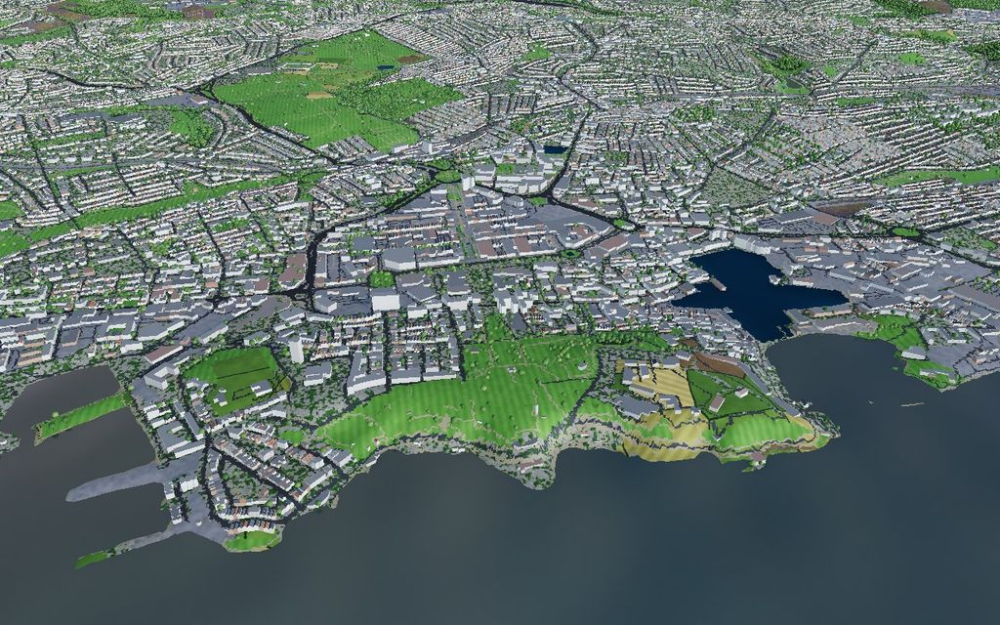

The same view with aggregated 75 m blocks: a tidier, SimCity-like toy, but it loses the street pattern.

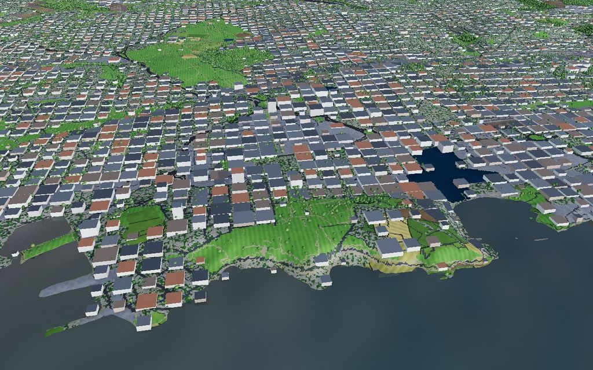

### Towns at regional scale (13 km out over Plymouth Sound)

At life size the city reads as a grey texture with roads; the shape is right but buildings are barely visible.

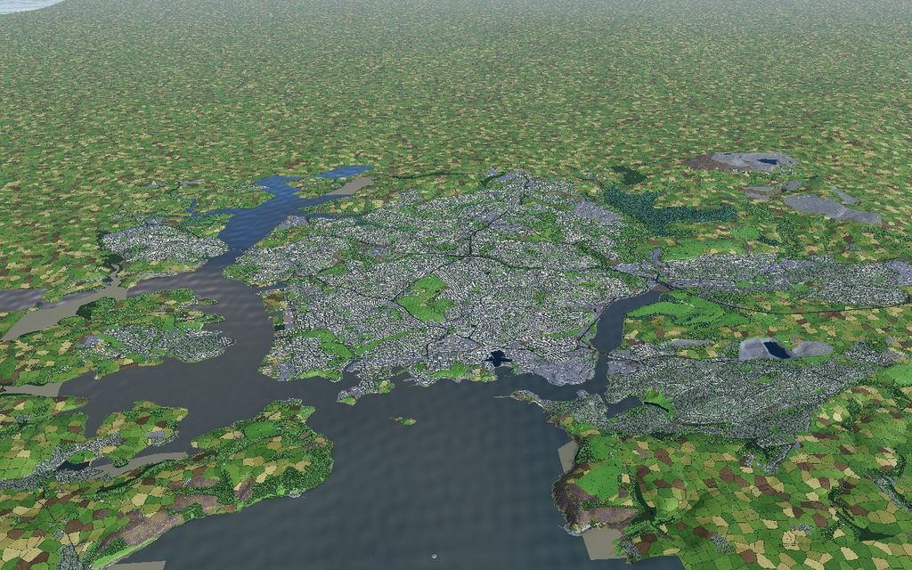

Footprints stretched 4× and trees 3×: the city stands up from the landscape and is clearly a city.

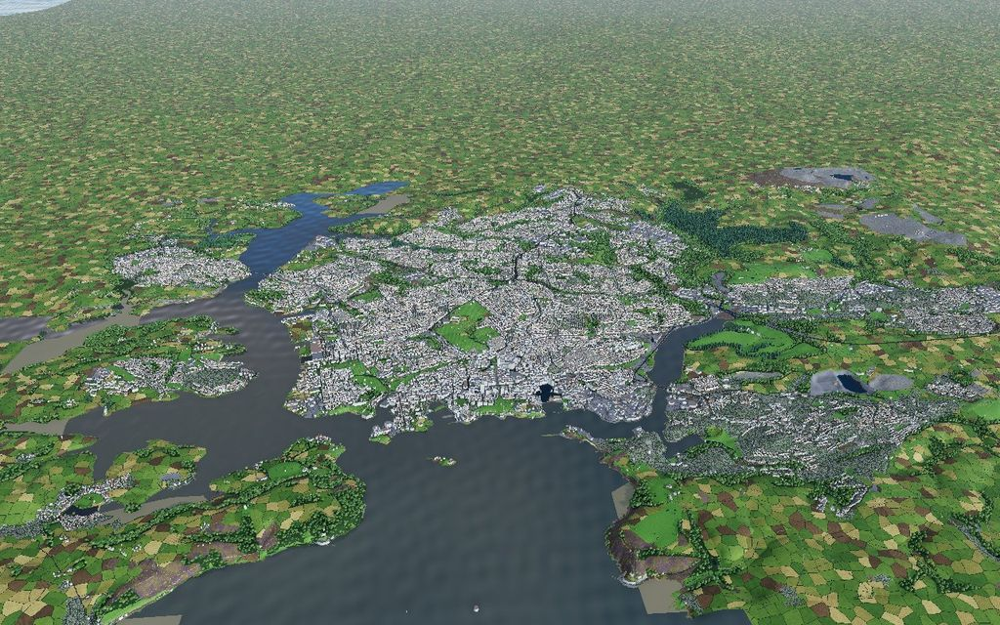

Blocks of 150 m at 3× height: the most legible at this distance, and the cheapest to draw and bake.

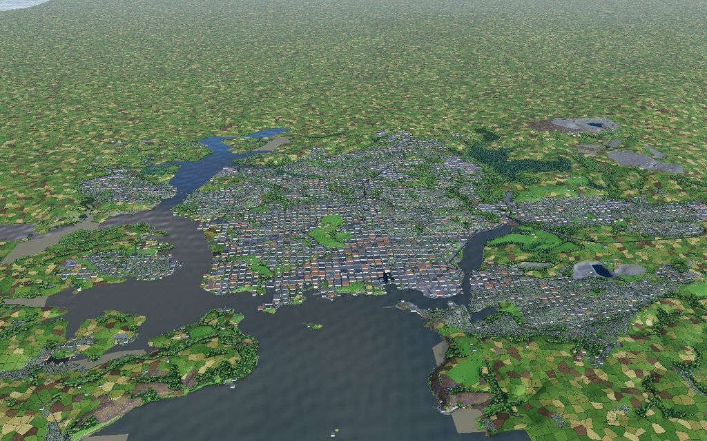

### Towns far out (26 km)

Life size: Plymouth is a grey smudge. Blocks of 250 m at 6× and trees at 5× still show it as a town.

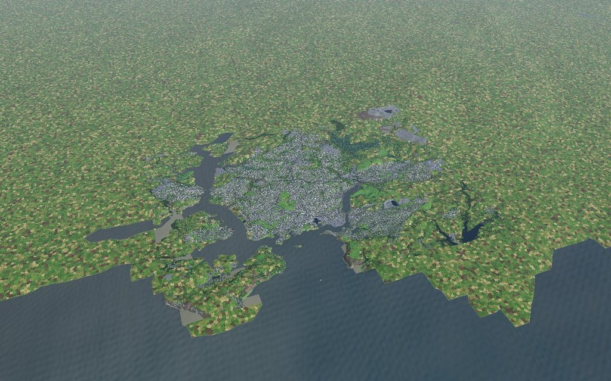
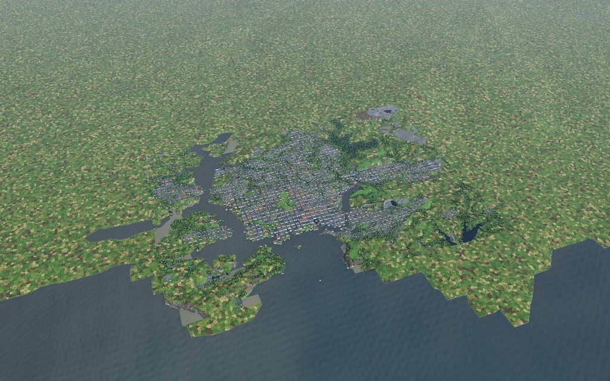

### Merged street blocks: blocks that follow the town's shape

Grid blocks read well from a distance but look like a grid. Merged street blocks keep the real outline of the town
and its street pattern, because they are built from the footprints and cut by the actual roads.

Close up, fine masses at 1.5×: terraces become continuous street fronts, the city-centre blocks and the Citadel keep
their real shapes.

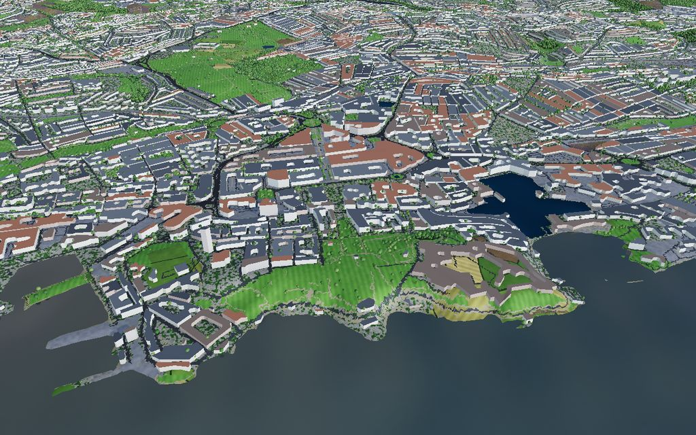

From 13 km, fine and coarse masses at 3× with trees at 3×:

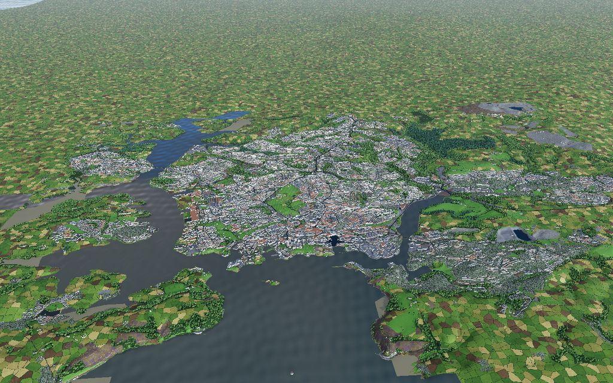
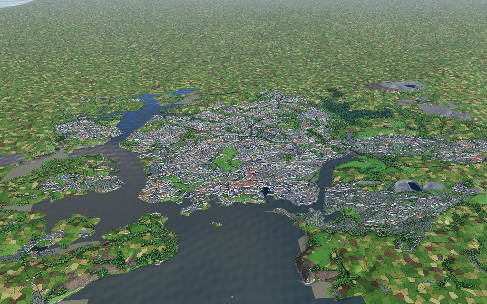

From 26 km, coarse masses at 6× and trees at 5×:

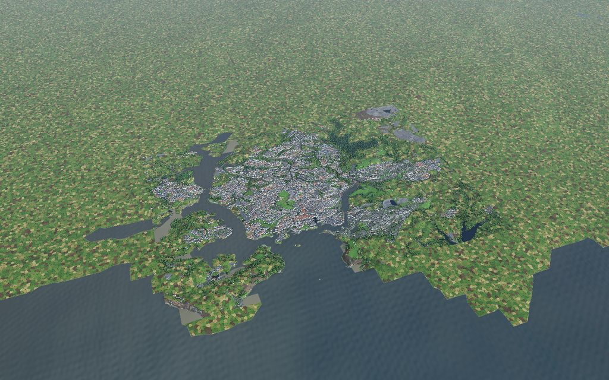

### Forests (Kielder)

Close to Kielder Water at life size: conifer plantations, clear-fells, moorland and farmland.

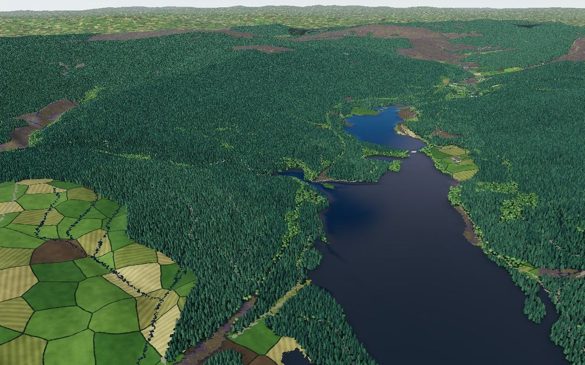

Trees at 3× in the same view: chunkier, more toy-like, still forest-shaped.

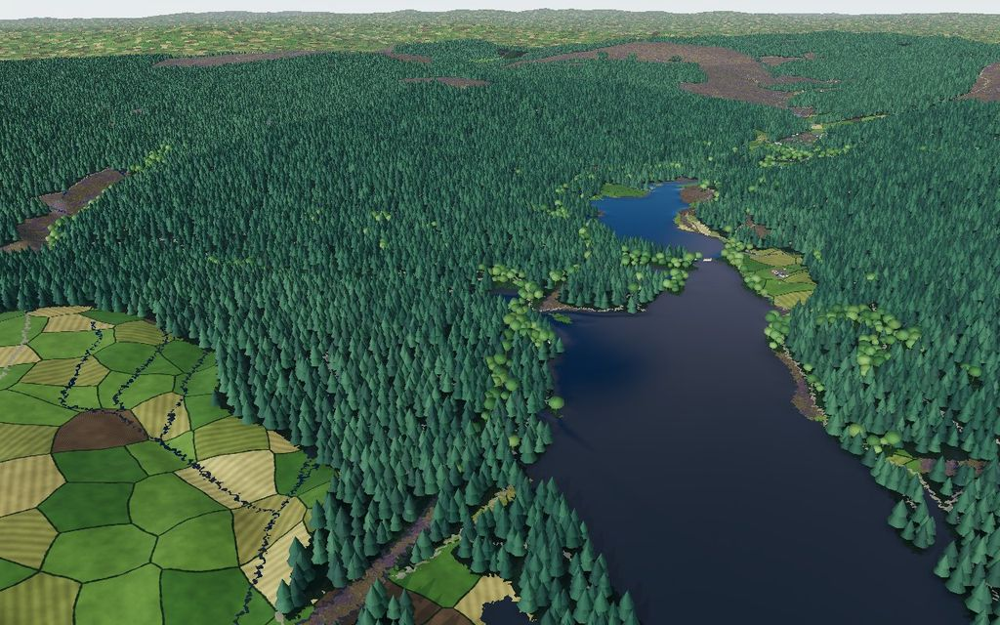

From 26 km: at life size the forest reads as a fine texture; at 5× it gets a chunkier, darker canopy with visible
trees. The edge of the detailed tile is obvious here because the surroundings have no land cover yet.

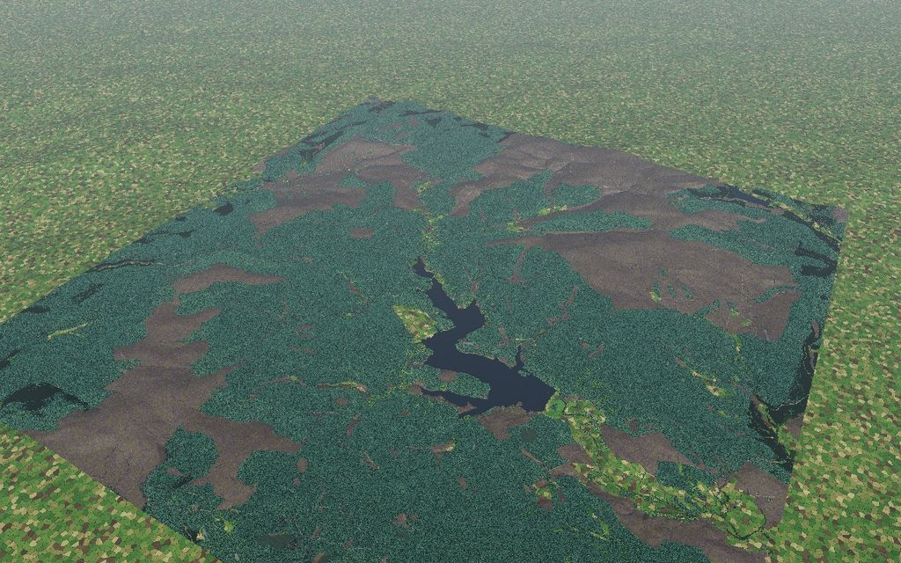
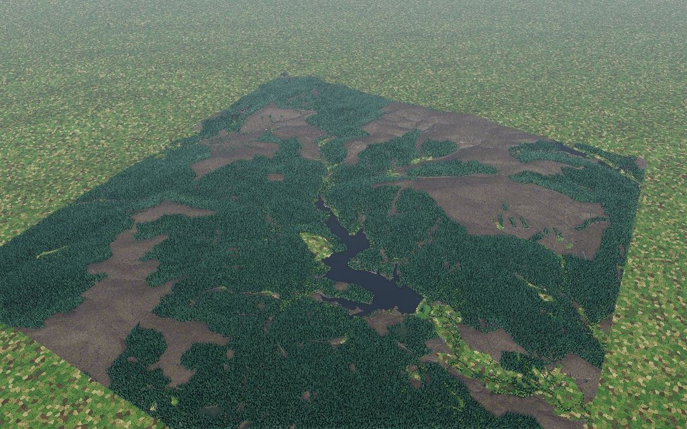

## Recommendation

Andy's feedback (2026-10-21): the approach is fine, but not grid blocks; blocks must follow the real shape of the town.
The merged street blocks above do that, so the plan uses them in place of grid blocks.

Draw things at the scale that suits the camera, not one fixed scale:

1. **Ground texture everywhere** from a baked UK land-cover raster plus the procedural detail. This is the biggest
   single improvement over today's height tint, and it is what makes the surroundings in the screenshots look flat.
2. **Towns as merged street blocks when far, footprints when near**: coarse masses at regional zoom, fine masses
   closer in, real footprints close up, with vertical exaggeration that eases from about 4–6× far out to 1× close up.
   Masses are small enough to keep a whole region loaded; footprints are streamed per tile only near the camera.
3. **Trees exaggerated with distance** in the same way (around 3–5× far, 1× near), using the woodland polygons for
   placement.

## What a UK-wide bake would involve

- **Land cover**: rasterise WorldCover, OSM land use, water and roads per tile. At 8 m the UK is roughly 20
  gigapixels, so it needs a tile pyramid (for example 10 km tiles at 4–8 m, plus coarser levels) rather than one
  texture. The 1 km UK view could use a 50–100 m version.
- **Merged street blocks**: run the closing-and-cut step per tile (with a margin so blocks do not split at tile
  edges). Scaling Plymouth's sizes by footprint count gives very roughly 300 MB (fine) and 150 MB (coarse) for the
  UK, so these are tiled too, but far fewer tiles are needed at once than for footprints. At about 45 seconds per level
  for Plymouth's 97k buildings, the UK is a few CPU hours per level, and the tiles run in parallel.
- **Footprints**: tile the 30 million footprints into binary tiles; Plymouth's 97k buildings are 4.7 MB, so the UK is
  likely over 1 GB in total and must be streamed by tile, which fits the planned S3/CloudFront hosting.
- **Trees**: no need to bake points; the land-cover tiles carry woodland and the browser scatters trees.
- The bake is a batch job reading Overture straight from S3, in the same style as the UKV pipeline.

## Known issues in the prototype

- The surroundings use the 1 km heightmap, so their coastline steps and they sit slightly differently from the tile;
  the tile edge is visible in the far views.
- The field pattern shimmers and gets busy at distance; it needs to fade to an average colour with distance.
- Woodland type (conifer vs broadleaf) is guessed, as above.
- Grid blocks are on a regular grid, which looks artificial; merged street blocks replace them.
- Merged masses use one mean height per block, so a block that mixes houses and a tower block averages them.
- Performance on a real GPU has not been measured. Kielder has about 400 km² of woodland in the test box, which is
  about four million tree instances at life size (10 m spacing). The full map will need distance culling or
  impostors.
