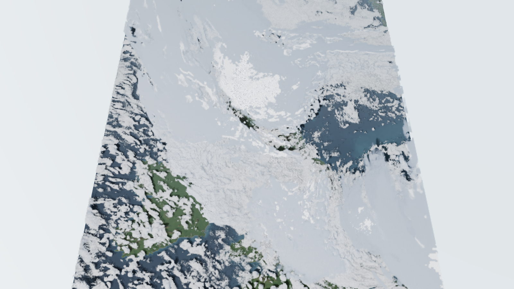
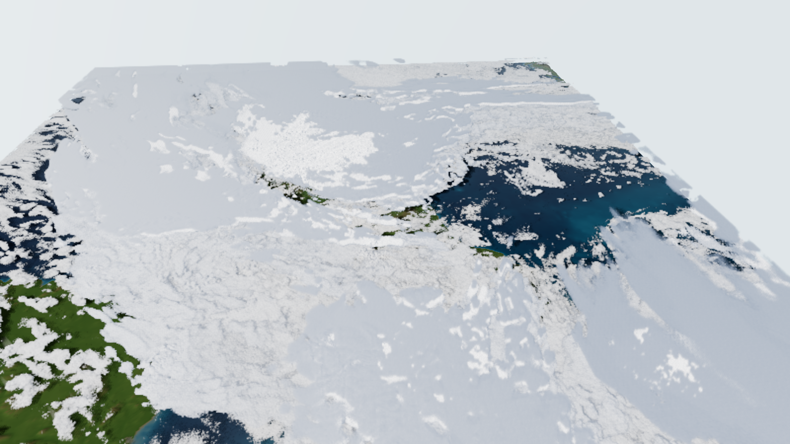
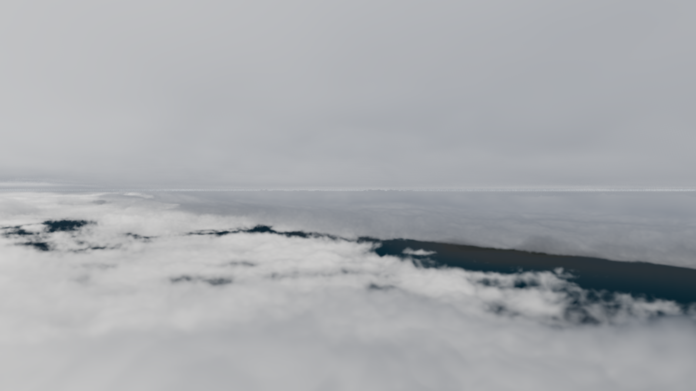
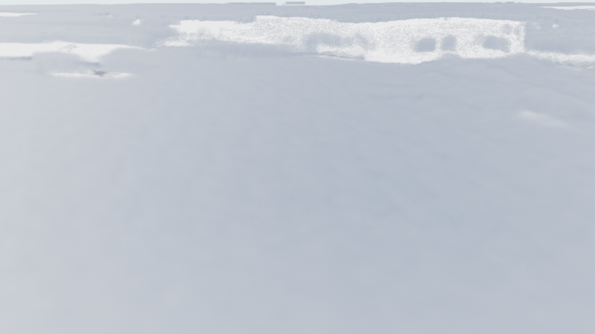
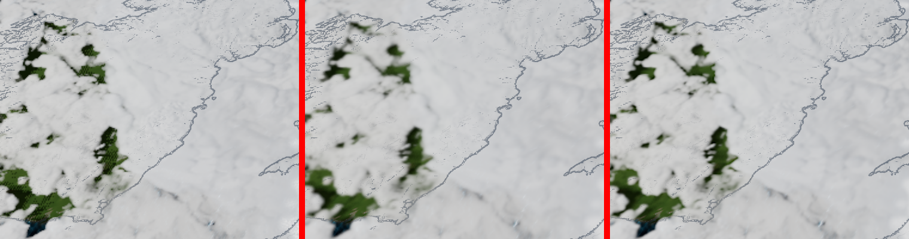

# UKV clouds and rain on the map

A first proof of concept that draws one real UKV hour of cloud and rain as a raymarched volume over the 3D map. It
builds on [volumetric-clouds-and-rain.md](volumetric-clouds-and-rain.md) (the approach) and
[cloud-lab.md](cloud-lab.md) (the look of each cloud type on flat ground).

The app's goal is to show the weather for the next hour. For this PoC the hour is fixed: run 2026-10-21 09Z, step
T+3, valid **2026-10-21 12:00 UTC**. On that hour a large frontal overcast covers most of the domain, with broken
cumulus in the south-west and a clear patch over the Irish Sea. The heaviest rain is 23.3 mm/h.

## How it works

### Pipeline: `pipeline/ukv_clouds.py`

```
python ukv_clouds.py --run 20261021T0900Z --step 3 --out-dir ../public/data --cache <dir>
```

It downloads five fields for one hour from the public bucket `met-office-atmospheric-model-data`
(see [ukv-data-access.md](ukv-data-access.md)) and crops them to the terrain's extent (541 x 681 cells at 2 km):

| Field | Used for |
|---|---|
| `cloud_amount_on_height_levels` (33 levels, 5 m to 6 km AGL) | the 3D cloud volume |
| `precipitation_rate` | rain shafts and darkening |
| `height_AGL_at_cloud_base_where_cloud_cover_2p5_oktas` | where rain starts |
| `cloud_amount_of_high_cloud` | a thin cirrus sheet from 7.5 to 10.5 km, since the 3D field stops at 6 km |
| `CAPE_surface` | convective (tall, lumpy) against layered (flat) cloud |

UKV has no cloud-type field, so the type is implied by these fields rather than read. Outputs, all in `public/data/`:

- `ukv-clouds-volume.png`: an 8-bit atlas of cloud fraction on 30 uniform 200 m slices (4.9 MB).
- `ukv-clouds-2d.png`: RGBA with rain, cloud base, high cloud and CAPE. The encodings are in the JSON.
- `ukv-clouds.json`: grid, slice layout, valid time, encodings and the Met Office attribution.

### Renderer: `src/weather/clouds.ts` and `src/weather/cloudShaders.ts`

- The scene renders to an MSAA target with a depth texture. A half-resolution full-screen pass then raymarches the
  clouds, stopping at the terrain depth, and writes cloud colour and a cloud shadow for the ground (two render targets).
- Cloud fraction from the volume sets the coverage. Perlin–Worley shape noise and Worley detail noise from the cloud
  lab carve it into billows, so a 2 km grid cell does not look like a block. Detail fades out with distance.
- Clouds sit above the terrain (heights are AGL). The vertical scale follows the map's terrain exaggeration, and the
  "Cloud height" slider scales the cloud layer on its own (default 3). "Cloud opacity" fades the clouds over the map
  (default 0.75).
- Lighting: sun march for self-shadowing, two-lobe Henyey–Greenstein phase, multiple-scattering octaves, powder
  term, and energy-conserving integration (Hillaire).
- Rain below the cloud base uses Shipley's extinction, σ = 0.16 R^0.74 per km, with vertical streak noise. Raining
  cloud is darkened.
- Each frame marches one jittered sample per pixel and blends it with the history from earlier frames:
  - **Still camera:** a running average. Once 32 frames have been averaged, the clouds are no longer marched, so a
    still view costs nothing extra.
  - **Moving camera:** temporal reprojection. The cloud pass also writes each pixel's transmittance-weighted mean
    cloud distance. The accumulate pass turns that into a world position and projects it with last frame's camera to
    find the history pixel. The cloud shadow on the ground uses the scene depth instead. History is fetched with a
    5-tap Catmull–Rom filter, because bilinear fetches blur a little more every frame. It is then clipped to the mean
    ± 1.5σ of this frame's 3 × 3 neighbourhood, which stops stale history ghosting. The result is an exponential blend
    with weight 1/10 per frame.
  - **Rejecting history:** history is thrown away where the pixel was off screen last frame, or where the stored
    distance disagrees with the expected one by more than 25% + 0.2 km (a cloud edge or hill crossed the pixel).
  - **Fast flights:** the history weight drops to zero as the camera travels from 1% to 8% of the cloud distance in
    one frame. A dive through a deck a few km thick therefore falls back to the noisy current frame instead of
    smearing.
  - **When the clouds change:** `CloudLayer.invalidate()` throws the history away. Changing the cloud height,
    changing the exaggeration or resizing the window calls it. Animating through UKV timesteps should call it on
    each step change. For smooth interpolation between steps, the lower-weight moving path would do.
- The HUD has a "Clouds and rain" toggle, the "Cloud height" and "Cloud opacity" sliders, an "Outline land under
  cloud" switch (coastline plus 200 m contours drawn over the cloud, at full resolution from the scene depth) and the
  valid time.
- Rain falls only from where the shape noise leaves cloud at the base, so shafts hang under clouds rather than filling
  a whole 2 km grid cell as a smooth column.

## Screenshots

Rendered on an AMD Radeon RX 7700S (laptop) at 1600 x 900, after 32 accumulated frames.

**Overview.** The frontal overcast with broken cumulus over the south-west at bottom left. The sides of the data
domain fade out instead of ending in a cut.



**Default view.** Relief on the overcast tops is visible but weak. The clear patch over the Irish Sea shows sea through
the gap.



**Low view, about 4 km up.** Broken cloud tops with the ground showing through the gaps. This is the most
convincing view so far.



**Under the rain.** The camera is in or just above the deck, so the foreground is near-white haze. No rain shafts can
be seen yet.



## Performance

Measured on the RX 7700S through ANGLE / Direct3D 11, 1600 x 900, clouds at half resolution with 160 steps, vsync on
(display about 165 Hz). Averages over 5 seconds at the default view unless noted.

| Case | Frame time |
|---|---|
| Clouds off | 6.1 ms |
| Clouds on, camera panning | 31.5 ms (p95 36.5 ms), about 32 fps |
| Clouds on, camera orbiting | 32.2 ms |
| Clouds on, camera still (converged) | 6.2 ms |
| 5 s descent from the default view to 0.5 km above ground | 27.5 ms average: 32.5 ms high up, 33 ms through the deck, 17 ms below it |

Reprojection costs nothing measurable: the same pan took 33.6 ms before it and 33.2 ms after. It does not make
moving frames cheaper; it makes them cleaner. Each pixel still marches one sample per frame, but it now averages
about ten frames of history instead of showing a single noisy sample. An earlier build marched every frame and took
about 38 ms whether moving or still.

**While orbiting** (crop of the default view). Left: no reprojection, each frame a single noisy sample. Middle:
reprojection with bilinear history, clean but smeared. Right: reprojection with Catmull–Rom history, as shipped.



How it looks in motion:

- **Panning and orbiting:** the per-pixel grain and dither are gone. Cloud edges are slightly softer than when still,
  and a little noise remains along cloud edges where history is rejected or clipped. No trails were visible.
- **Descent:** the dive has no visible ghosting. Frames in and just above the deck match the build without
  reprojection, because the travel test hands those pixels to the current frame. They are as noisy as before, but
  not smeared.

## Known gaps

- **Too bright.** Big overcast areas are close to blown-out white with little contrast. Sun strength, ambient light
  and exposure need tuning against reference photos.
- **No visible rain shafts.** Rain is modelled but does not show in any of the four views.
- **Inside the deck.** With the camera in or just above the cloud, the view is a featureless haze.
- **Horizon speckle.** In the low view, a thin bright speckled line remains at the horizon.
- **Far edge.** The domain's far (north) edge is still fairly straight.
- **Moving cost.** About 32 ms a frame while moving on this GPU. Reprojection made motion clean but not cheaper.
  Next ideas: march fewer pixels per frame (checkerboard or 1 in 4, filled from the reprojected history), an
  empty-space skip from the volume, and fewer steps while moving.
- **Under the deck.** Below the overcast the ground is almost black, darker than an overcast day should be.
- **One static hour.** The next step towards the product goal is loading the coming hour from the latest run.
- **Above 6 km.** The 3D field stops at 6 km, so thunderstorm tops and anvils are not modelled yet (see the research
  note for the heuristics).

Contains Met Office data © Crown copyright, licensed under CC BY-SA 4.0.
