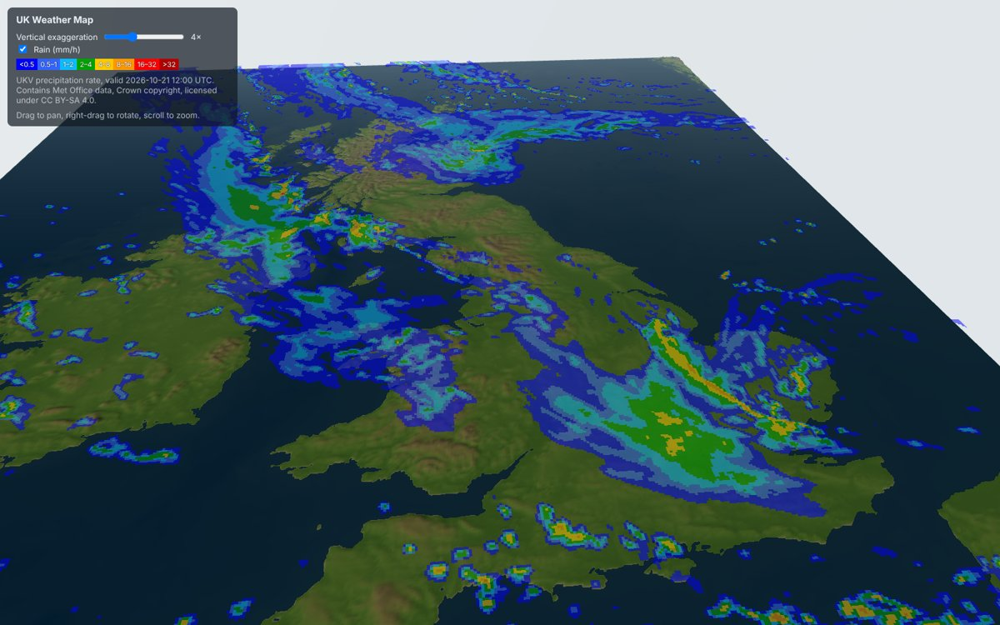
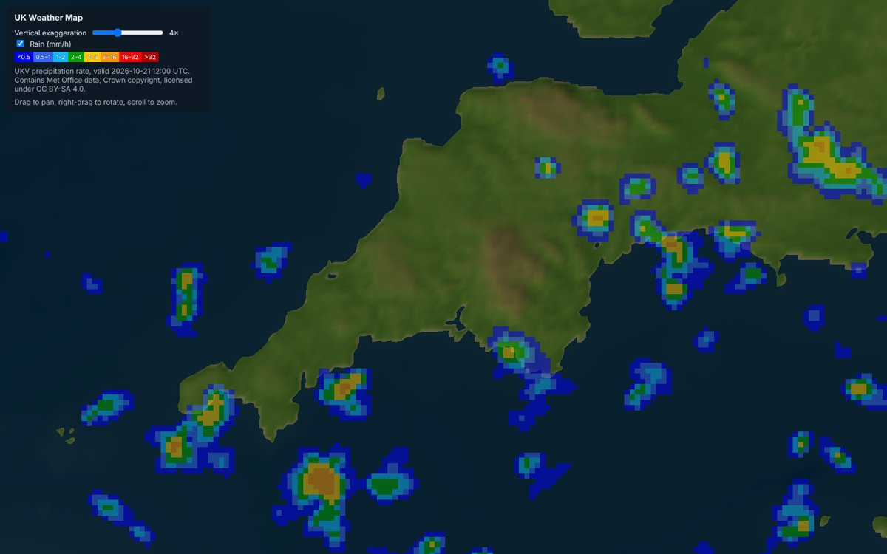

# UKV and terrain alignment check

Checked on 21 October 2026, to confirm that UKV fields line up with the 3D terrain before building weather
layers on top of it.

## Result

The UKV grid and the terrain are registered correctly. No offset or resampling is needed.

## How the two grids relate

- The terrain (`public/data/uk-heightmap.json`) is a 1 km grid in UKV LAEA metres
  (`+proj=laea +lat_0=54.9 +lon_0=-2.5 +ellps=GRS80`). It runs from x = -640 000 to 440 000 and from
  y = -640 000 to 720 000.
- The UKV cell centres sit at x = -1 158 000 + 2000 i and y = 902 000 - 2000 j (see `pipeline/README.md`).
- The terrain's edges fall on UKV cell centres: column 259 and row 91 of the UKV grid. So every second terrain
  sample is exactly a UKV cell centre.

## Visual check

`src/rain.ts` draws the UKV `precipitation_rate` field (run 20261021T0900Z, valid 12:00 UTC) on a half-transparent
plane above the terrain. The shader looks up the UKV cell from each fragment's world position in LAEA metres, so
any misregistration would show as rain cells shifted against the coastline. None is visible. The colours are the
Met Office website's mm/h key (<0.5 `#0000fe`, 0.5–1 `#3265fe`, 1–2 `#0cbcfe`, 2–4 `#00a300`, 4–8 `#fecb00`,
8–16 `#fe9800`, 16–32 `#fe0000`, >32 `#b30000`), sampled from a screenshot of the site. The field is in m s-1, so
multiply by 3.6 × 10⁶ for mm/h.

*Looking north over the British Isles at 4× vertical exaggeration.*

*Top-down over Devon and Cornwall. Each square is one 2 km UKV cell. Cells under 0.1 mm/h are left transparent.*

## Numerical check

I compared the UKV `landsea_mask` (same run, T+3) with the terrain's land cells (height > 0), over the terrain's
whole extent:

- **2 km grid** (terrain sampled at UKV cell centres): the best agreement is at zero offset, where 98.9% of
  cells match.
- **1 km grid** (UKV mask repeated to 1 km): the best fit is about 1 km away from zero offset, which is half a
  UKV cell. The terrain coastline comes from Natural Earth 10 m land, and the UKV mask is the model's own
  rasterised coastline. A difference of this size between two coastline sources is expected, so I don't read it
  as a real offset.
