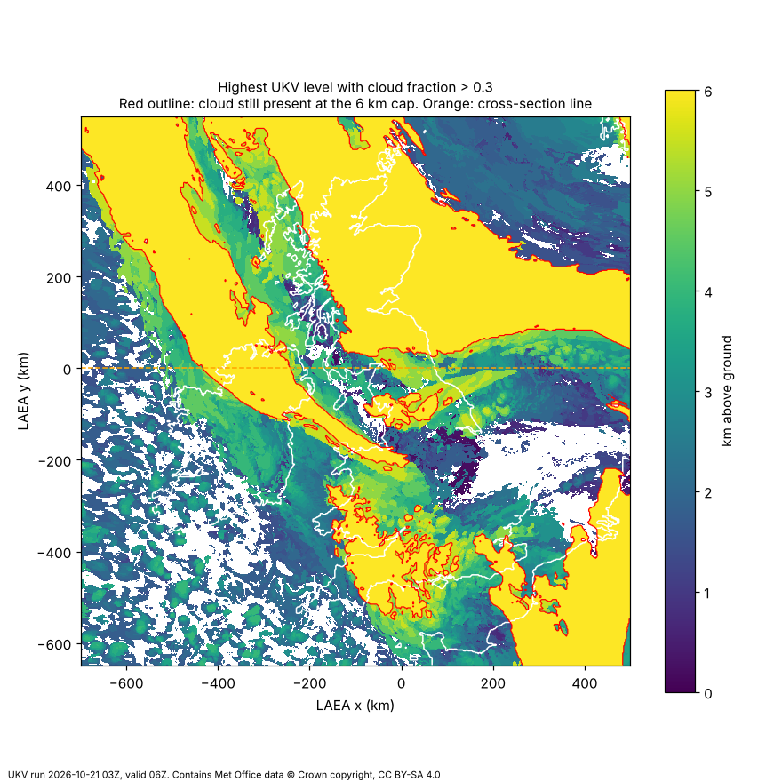
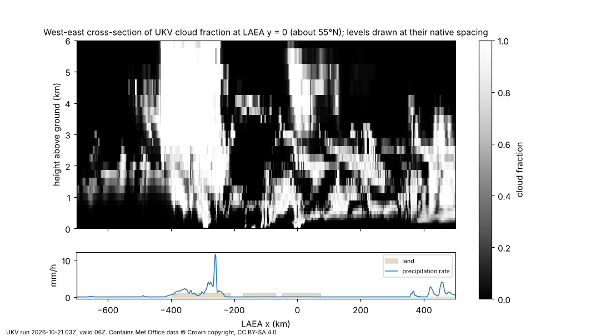

# Volumetric clouds and rain

Research note, 21 October 2026. Also kept as a doc: [Volumetric clouds and rain](https://claude.ai/artifact/JR7ovuERruDC3dm8S8GSRo).

UKV does not give cloud type. It gives cloud fraction (as % cover in bands, and as a full 3D field on 33 height levels up to 6 km), plus cloud base, CAPE, rain, hail and lightning. That is enough to derive a convincing type and look per grid cell, and to drive a raymarched volumetric renderer of the kind used in the Horizon games.

## What UKV gives us

I listed every file for one timestep (run 03Z on 21 Oct 2026, T+3h) and opened the cloud and storm files. There are 52 parameters per hourly step and none of them is a cloud type or a cumulonimbus flag. The 15-minute steps carry only 12 surface fields, without any cloud.

| Field (file name) | What it is | Size per step | Use for visuals |
| --- | --- | --- | --- |
| `cloud_amount_on_height_levels` | Cloud volume fraction 0–1 on 33 levels, 5 m to 6,000 m above ground | 20 MB | The 3D density field itself |
| `cloud_amount_of_low/medium/high_cloud` | Cover 0–1 in bands of about 111–1,949 m, 1,949–5,574 m and 5,574–13,608 m | 0.3–1.2 MB | High band is the only cloud information above 6 km (cirrus, anvils) |
| `cloud_amount_of_total_cloud`, `cloud_amount_below_1000ft_ASL`, `fog_fraction_at_screen_level` | Column cover, very low cloud, fog | 0.2–0.7 MB | Overcast and fog layers |
| `height_AGL_at_cloud_base_where_cloud_cover_2p5_oktas` | Cloud base in m above ground | 0.7 MB | Flat cloud bottoms, start of rain shafts |
| `CAPE_surface`, `CAPE_most_unstable_below_500hPa` | Convective energy, J/kg | 0.5–0.6 MB | How towering and "boiling" convective cloud should look |
| `precipitation_rate`, `rainfall_rate`, `snowfall_rate` | Rate at the surface, m/s (multiply by 3.6 million for mm/h) | 0.1–1 MB | Rain shaft density, cloud darkening |
| `hail_fall_rate`, `lightning_flash_accumulation-PT01H` | Hail rate; lightning flashes per m² in the past hour | 0.08 MB | Storm cells: lightning flashes, hail cores |
| `relative_humidity_on_pressure_levels`, `temperature_on_pressure_levels` | 33 pressure levels from 1000 to 10 hPa | 35 / 25 MB | Can extend clouds above 6 km by heuristic |
| `height_AGL_at_freezing_level`, `wind_*_on_height_levels` | Freezing level; wind on height levels | 1.6 / 47–72 MB | Snow vs rain, cloud drift and shear |

Two findings from the sample matter for rendering:

- **The 3D cloud field stops at 6 km.** In that sample, 39% of the cloudy columns still had more than 30% cloud at the 6,000 m level. Thunderstorm tops normally go well above 6 km, so tops and anvils have to come from the high-cloud band, the humidity fields or art direction.
- **The vertical spacing is coarse aloft.** Levels are 5–50 m apart near the ground but 250–500 m apart above 1 km, so the data gives the envelope of a cloud, and noise has to supply the billows. The horizontal grid is 2 km, so a single fair-weather cumulus (often under 1 km across) is sub-grid and must also come from noise.

The map shows the highest level in each column with more than 30% cloud. Yellow areas inside the red outline still have cloud at the 6 km cap, so their real tops are unknown. Large continuous bands reach the cap, while the scattered cells to the south-west top out at 1 to 3 km.

The cross-section along the orange line shows the data's vertical structure. The columns of near-solid cloud over Northern Ireland and over the Scotland–England border run straight into the 6 km ceiling. The horizontal striping is the level spacing becoming coarser with height. The heaviest rain on this line (11.6 mm/h) sits under the deepest cloud, which is the link the rain shafts should follow.

The band heights come from the Met Office datasheet for this dataset. That datasheet is older than the bucket: it omits the height-level cloud, cloud base, hail and lightning files that the live bucket has. The max rain rate in the sample was 24.7 mm/h, and about 10% of cells had over 1 mm/h.

## Deriving cloud type

Type has to be inferred in the pipeline, per 2 km column, and written into an extra texture channel. This is the same idea Horizon Zero Dawn used: its weather map has coverage, precipitation and cloud type channels, and type blends between density-with-height profiles. The TU Wien thesis that renders ICON-D2 output does something similar with a "convective weight" that blends a smooth stratiform noise path and a billowy convective one.

The rules below are a starting proposal, not a Met Office scheme. Every threshold is a guess to tune by eye against satellite and webcam pictures.

| Type | Rule from UKV fields (per column) | Look to aim for |
| --- | --- | --- |
| Fog / stratus | Cloud in the lowest levels or base under about 300 m, depth under 1 km, CAPE near 0 | Flat, smooth, grey sheet hugging terrain |
| Stratocumulus | Low layer only, depth under about 1.5 km, cover 0.5–0.95, low CAPE | Lumpy sheet with gaps, flat base |
| Fair-weather cumulus | Base 0.5–1.5 km, depth under about 2 km, partial fraction, little or no rain | Scattered bright white puffs, flat bases, sharp tops |
| Cumulus congestus | Depth 2–6 km, CAPE in the hundreds of J/kg, showers | Tall cauliflower towers, darker bases |
| Cumulonimbus | Cloud still present at the 6 km cap, high-cloud cover above, CAPE high, and rain over about 5 mm/h or any lightning or hail | Towering column, anvil spread from the high band, very dark base, rain shafts, lightning |
| Nimbostratus | Deep layered cloud (low and medium cover both high), low CAPE, steady rain of about 1–4 mm/h | Thick uniform dark grey, broad diffuse rain |
| Altocumulus / altostratus | Cloud only between about 2 and 6 km | Mid-level sheet or rows of small cells |
| Cirrus / cirrostratus | Only the high band has cover | Thin wispy layer in the high band (about 5.6–13.6 km), mostly translucent |

White versus dark mostly falls out of the physics once density and depth are right. A thin cumulus scatters most sunlight out of its sides and looks white. A 6 km deep cloud lets almost no light through to its base, so the base looks dark from below and from the side, and Beer–Lambert attenuation in the raymarcher produces that. Horizon added extra absorption where its precipitation channel was high to darken rain clouds further. That is an art-directable knob we can drive from `precipitation_rate`.

## Rendering the clouds

The best-looking real-time clouds today are raymarched volumes lit with a physically based single-scattering model plus cheap multiple-scattering tricks. UKV already is a voxel grid, which makes Guerrilla's newest approach (Nubis³, voxel clouds, 2023) the closest match to our data.

**The ingredients, all from published work:**

1. **Density volume.** Bake UKV cloud fraction, our derived type and rain rate into a 3D texture (`THREE.Data3DTexture`). Horizontal 2 km, vertical resampled to a uniform step. The TU Wien thesis resampled ICON-D2 onto a uniform metric grid with PCHIP interpolation for the same reason.
2. **Detail noise.** Erode the coarse envelope with tiling noise so the edges billow. Horizon used a 128³ Perlin–Worley base texture, a 32³ Worley detail texture and a 2D curl-noise texture to fake turbulence. The type channel decides how hard to erode: smooth for stratus, billowy for cumulus.
3. **Lighting.** Beer–Lambert attenuation toward the sun, a Henyey–Greenstein phase function for the bright silver lining when looking toward the sun, and Horizon's "powder" term that darkens sun-facing edges. Multiple scattering is approximated by summing a few attenuated octaves; takram's library defaults to 8 (`multiScatteringOctaves`). Ambient sky light varies with height in the cloud.
4. **Shadows on the terrain.** Raymarch the clouds once from the sun into a shadow map (takram calls it a Beer shadow map) and sample it in the terrain shader. Moving cloud shadows over the UK hills will be one of the most striking effects on a map, and it is cheap once the volume exists.
5. **Aerial perspective.** Distant clouds should fade into atmospheric haze. takram ships a matching atmosphere package (`@takram/three-atmosphere`).
6. **Speed.** Raymarch at half or quarter resolution, jitter the start of each ray with blue noise, and reproject across frames. Horizon updated 1 pixel in 16 per frame and targeted about 2 ms on PS4. The TU Wien WebGPU renderer measured about 2.25 ms worst case on an RTX 5070 Ti at 1280×720. Empty-space skipping (Nubis³ uses signed distance fields) avoids wasting steps over clear sky.

**Three ways to build it:**

| Option | Good | Problems for us |
| --- | --- | --- |
| [@takram/three-clouds](https://cdn.jsdelivr.net/npm/@takram/three-clouds@0.7.4/README.md) (MIT, Three.js + postprocessing) | Best-looking open Three.js clouds found: shadows, light shafts, multi-scattering, quality presets | Built for a globe (altitude from the ellipsoid, weather texture tiled with cube-sphere UVs); weather input is 2D and limited to 4 layers; no 3D density input; WebGPU not supported yet. It would need forking to take UKV data. |
| Own raymarcher in our scene, WebGL2 GLSL | Full control, takes the UKV volume directly, fits our flat LAEA km scene | More work. We can borrow takram's shader code (MIT) and the published Horizon methods. |
| Own raymarcher on WebGPU (`WebGPURenderer` + TSL) | Compute shaders for baking volumes and distance fields; the TU Wien thesis proves the approach in a browser with NWP data | That thesis's 1.14 GiB texture atlas exceeded Firefox's WebGPU limit, so it needed Chromium. Our scene uses `WebGLRenderer` today. |

**Recommendation:** build our own raymarcher on WebGL2 now, porting takram's lighting code where useful, because no off-the-shelf library takes a real 3D weather field. Keep WebGPU as a later upgrade.

**Size check.** The full UKV volume is 1042 × 970 × 33 ≈ 33 million voxels. At one byte per voxel that is 33 MB per timestep, before cropping. Cropping to the British Isles and packing type and rain into a small 2D texture alongside should bring it well under that, but this has not been measured.

## Rain shafts

Treat rain as a second participating medium in the same raymarch, filling the space from the cloud base down to the terrain wherever `rainfall_rate` is above zero. Its opacity can come from a measured relation between rain rate and optical extinction instead of guesswork. Shipley and others (1974, lidar) found σ ≈ 0.16 R^0.74, with σ in km⁻¹ and R in mm/h. A 2025 study in *Atmósfera* fitted similar curves (σ ≈ 0.11–0.12 R^0.81–0.88) and quotes higher coefficients for thunderstorm and orographic rain.

| Rain rate | σ (Shipley) | Light getting through a 2 km wide shaft |
| --- | --- | --- |
| 1 mm/h, light rain | 0.16 km⁻¹ | about 73% |
| 5 mm/h, moderate | 0.53 km⁻¹ | about 35% |
| 25 mm/h, the heaviest cell in our sample | 1.7 km⁻¹ | about 3% |

Because our scene is in real kilometres, plugging this in gives a physically sensible range: faint veils in drizzle and near-opaque grey curtains under storms. On top of that:

- **Shape.** Stretch the noise vertically so the shaft has streaks, soften its edges across neighbouring cells, and tilt it with the wind on height levels.
- **Snow.** Use `snowfall_rate` with a whiter, softer, more scattering medium, and `height_AGL_at_freezing_level` to decide where snow turns to rain.
- **Lightning.** `lightning_flash_accumulation-PT01H` is flashes per m² per hour. One 2 km cell is 4 million m², so the busiest cell in the sample works out at about 0.6 flashes per hour. That can drive random flashes, lighting the cloud volume from inside.
- **Close to the ground.** Streak particles and wet-surface effects (Tatarchuk, 2006) only matter if the camera gets down to street level. From map height, the volumetric shaft is what people see.
- **Animation.** Rates are instantaneous and the cloud fields are hourly, so blend between consecutive hours in the shader. The 15-minute steps for the first hours carry rain rate but no cloud.

Virga (rain that evaporates before reaching the ground) cannot be shown from this data, because the published files only give the rate at the surface.

## Build order and unknowns

1. Extend `pipeline/ukv_to_grid.py` to bake `cloud_amount_on_height_levels` into a cropped 3D texture, plus a 2D texture of cloud base, derived type, rain rate and lightning.
2. Raymarch that volume over the terrain with Beer–Lambert and Henyey–Greenstein only, to check placement and scale.
3. Add detail noise, powder, multi-scattering octaves and the sun shadow map on the terrain.
4. Add rain shafts from the extinction formula, then lightning and snow.
5. Add half-resolution rendering with temporal reprojection once the look is right.

Not known yet:

- How smooth or blocky 2 km cells look from our camera heights. Only a prototype will tell.
- Whether high-cloud cover plus humidity on pressure levels gives believable anvils above 6 km, or whether they need to be art-directed.
- Frame rate on the target machines. The timings above are from other hardware and other scenes.
- The slides for Hillaire's 2016 Frostbite cloud talk and Nubis³ could not be opened during this research, so their details are not included.

## Sources

- Live bucket listing and files, `met-office-atmospheric-model-data/uk-deterministic-2km/20261021T0300Z/`, opened 21 Oct 2026
- [Met Office UK NWP datasheet for the AWS dataset](https://acct.metoffice.gov.uk/binaries/content/assets/metofficegovuk/pdf/data/uk-nwp-asdi-datasheet.pdf) (cloud band heights)
- Schneider, [The Real-time Volumetric Cloudscapes of Horizon Zero Dawn](https://www.advances.realtimerendering.com/s2015/The%20Real-time%20Volumetric%20Cloudscapes%20of%20Horizon%20-%20Zero%20Dawn%20-%20ARTR.pdf), SIGGRAPH 2015 Advances course
- Guerrilla, [Nubis³](https://www.guerrilla-games.com/read/nubis-cubed) (voxel clouds, 2023)
- takram, [@takram/three-clouds README](https://cdn.jsdelivr.net/npm/@takram/three-clouds@0.7.4/README.md), v0.7.4
- Muth, [Real-Time Volumetric Rendering of Meteorological Cloud Data](https://www.cg.tuwien.ac.at/research/publications/2026/muth-2026-clouds/), bachelor's thesis, TU Wien, 2026
- Montero-Martínez and García-García, [The influence of rainfall on the extinction coefficient and the meteorological optical range](https://www.scielo.org.mx/pdf/atm/v39/0187-6236-atm-39-53491.pdf), Atmósfera, 2025 (also the source for the Shipley 1974 relation)
- Tatarchuk, Artist-Directable Real-Time Rain Rendering in City Environments, EGSR 2006 (cited, not opened)
